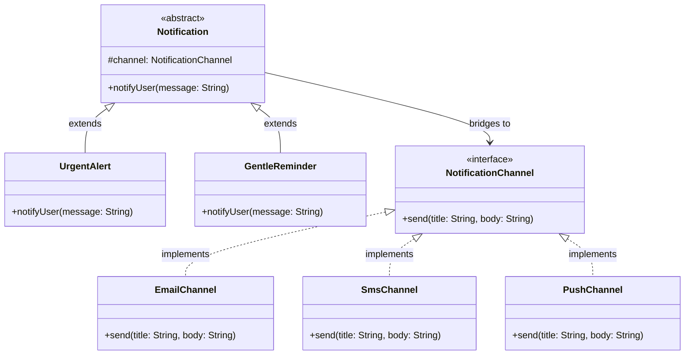
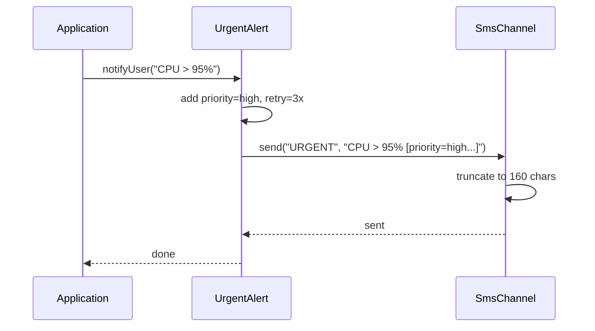

# Bridge Design Pattern

## Youtube

- [26. Bridge Design Pattern | LLD of Bridge Pattern with Example | Low Level Design of Bridge Pattern](https://www.youtube.com/watch?v=SOw1_W0taBg)

## 1. Overview and Fundamentals

**Intent (GoF):** Decouple an abstraction from its implementation so that the two can vary independently.

**In one line:** Bridge splits one exploding class hierarchy into two small hierarchies joined by composition.

**Real-world analogy:** A TV remote (abstraction) and the TV itself (implementation). You can have basic remotes and smart remotes (abstraction hierarchy) working with Sony, Samsung, or LG TVs (implementation hierarchy). A new TV brand does not force you to redesign remotes, and a new remote type works with all TVs.

**Family context:** Bridge is a *structural* pattern. Where Adapter fixes mismatch after the fact, Bridge is designed up front to prevent a Cartesian-product class explosion.

**Key participants:**

- `Abstraction` — high-level interface clients use (e.g., `Notification`, `Remote`, `Shape`).
- `RefinedAbstraction` — extends abstraction with variants (e.g., `UrgentAlert`, `GentleReminder`).
- `Implementor` — low-level interface abstraction delegates to (e.g., `NotificationChannel`, `Device`).
- `ConcreteImplementor` — specific platform/channel (e.g., `SmsChannel`, `EmailChannel`, `TV`, `Radio`).

**Core characteristics:**

- Uses composition: abstraction *has-a* implementor, not *is-a*.
- Both hierarchies evolve independently — M abstractions x N implementations needs M+N classes, not M*N.
- Implementation can be swapped at runtime via constructor or setter injection.
- Clients depend only on abstraction; they never import concrete implementors directly.
- Implementor interface must stay narrow and stable — it is the bridge contract.

**Mental model:**

```text
Notification (abstraction) ---> NotificationChannel (implementor)
UrgentAlert / GentleReminder     Email / SMS / Push
```

If you control both sides and see two orthogonal axes of change, it is a Bridge. If one side is fixed third-party code, it is an Adapter.

## 2. Detailed Theory

**Problem:** A single inheritance hierarchy explodes. Classic example: `UrgentEmailAlert`, `UrgentSmsAlert`, `UrgentPushAlert`, `ReminderEmail`, `ReminderSms`, `ReminderPush` — every combination of message type and delivery channel is its own class. Adding WhatsApp means touching every message type; adding a new message type means touching every channel.

**Solution:** Split along the two axes. Put message semantics in one hierarchy (`Notification`) and delivery mechanics in another (`NotificationChannel`). Link them with a reference: `Notification` holds a `NotificationChannel` and delegates the actual send.

**Structure details:**

- **Abstraction** defines high-level operations (`notifyUser(message)`) and holds the implementor reference. It may add pre/post logic (priority headers, quiet-hours checks) before delegating.
- **RefinedAbstractions** vary the high-level policy without duplicating delivery code.
- **Implementor** defines primitive operations (`send(title, body)`). It should be minimal — wide interfaces force every channel to implement irrelevant methods.
- **ConcreteImplementors** encapsulate platform quirks: SMS truncation to 160 chars, email formatting, push payload limits.

**Bridge vs Strategy vs State vs Adapter:**

- **Bridge** is a long-lived structural split; both sides are hierarchies that grow.
- **Strategy** swaps one algorithm for one task at runtime; it is behavioural and typically single-level. The channel side of a Bridge is sometimes *implemented* with Strategy-style injection, which confuses interviewers — the difference is intent and longevity.
- **Adapter** retrofits incompatible code you do not control; Bridge connects two interfaces you designed together.
- **Abstract Factory** often *creates* the right implementor (e.g., `ChannelFactory.forRegion("EU")`), while Bridge *uses* it — the two patterns compose well.

**SOLID connections:**

- **Open/Closed:** New channel = one new class; new message type = one new class. Neither touches existing code.
- **Dependency Inversion:** Abstraction depends on `NotificationChannel` interface, not `SmsChannel` concrete.
- **Single Responsibility:** Message policy and transport mechanics live in separate classes.
- **Composition over Inheritance:** The core lesson — prefer has-a linkage over is-a explosion.

**Consequences:**

- Drastically fewer classes and independent testability, at the cost of an extra indirection and more types to understand for trivial systems.
- A leaky implementor interface (e.g., abstraction assuming SMS semantics) silently recouples the hierarchies — keep the contract platform-neutral.
- Overkill when only one implementation will ever exist; introduce when the second one appears.

## 3. UML and Architecture Diagrams

### Diagram 1 — Class structure (two hierarchies)



**Explanation:** The left hierarchy (`Notification` → `UrgentAlert`, `GentleReminder`) captures *what* to send and with what policy. The right hierarchy (`NotificationChannel` → Email/SMS/Push) captures *how* to deliver. The single arrow from `Notification` to `NotificationChannel` is the bridge — composition, not inheritance. Adding `WhatsAppChannel` touches only the right side; adding `MarketingPromo` touches only the left side.

### Diagram 2 — Runtime delegation (sequence)



**Explanation:** The client talks only to the abstraction. `UrgentAlert` enriches the message with policy (priority flags) and delegates the transport to whichever channel was injected. The channel handles its own constraint (SMS truncation). Neither side knows the other's concrete type — `UrgentAlert` works identically with email or push.

## 4. Implementation Examples in Java, Python, and Go

### 4.1 Java (OOP, abstraction + implementor hierarchies)

**Explanation:** `Notification` holds a `NotificationChannel` injected via constructor. `UrgentAlert` and `GentleReminder` differ in policy; `Email/Sms/PushChannel` differ in transport. `main` mixes any pair. Compile with `javac BridgeDemo.java && java BridgeDemo`.

```java
interface NotificationChannel {
    void send(String title, String body);
}

class EmailChannel implements NotificationChannel {
    @Override
    public void send(String title, String body) {
        System.out.println("[EMAIL] " + title + ": " + body);
    }
}

class SmsChannel implements NotificationChannel {
    @Override
    public void send(String title, String body) {
        String text = title + " " + body;
        if (text.length() > 160) text = text.substring(0, 160);
        System.out.println("[SMS] " + text);
    }
}

class PushChannel implements NotificationChannel {
    @Override
    public void send(String title, String body) {
        System.out.println("[PUSH] " + title + " -> " + body);
    }
}

abstract class Notification {
    protected final NotificationChannel channel;
    protected Notification(NotificationChannel channel) {
        this.channel = channel;
    }
    abstract void notifyUser(String message);
}

class UrgentAlert extends Notification {
    UrgentAlert(NotificationChannel channel) { super(channel); }
    @Override
    void notifyUser(String message) {
        channel.send("URGENT", message + " [priority=high, retry=3x]");
    }
}

class GentleReminder extends Notification {
    GentleReminder(NotificationChannel channel) { super(channel); }
    @Override
    void notifyUser(String message) {
        channel.send("Reminder", message + " [quiet-hours respected]");
    }
}

public class BridgeDemo {
    public static void main(String[] args) {
        Notification alert = new UrgentAlert(new SmsChannel());
        alert.notifyUser("Server CPU above 95%");
        Notification reminder = new GentleReminder(new EmailChannel());
        reminder.notifyUser("Your report is due Friday");
        Notification push = new UrgentAlert(new PushChannel());
        push.notifyUser("DB failover complete");
    }
}
```

**Sample I/O:**

```text
[SMS] URGENT Server CPU above 95% [priority=high, retry=3x]
[EMAIL] Reminder: Your report is due Friday [quiet-hours respected]
[PUSH] URGENT -> DB failover complete [priority=high, retry=3x]
```

### 4.2 Python (pythonic, ABC + composition)

**Explanation:** `Notification` stores a channel object (duck-typed, documented as `NotificationChannel`). Subclasses implement policy. Channels implement `send`. No framework needed — composition plus constructor injection is the whole pattern. Run with `python bridge_demo.py`.

```python
"""Bridge pattern: message types vary independently from delivery channels."""
from abc import ABC, abstractmethod


class NotificationChannel(ABC):
    """Implementor: how a message is delivered."""

    @abstractmethod
    def send(self, title: str, body: str) -> None:
        ...


class EmailChannel(NotificationChannel):
    def send(self, title: str, body: str) -> None:
        print(f"[EMAIL] {title}: {body}")


class SmsChannel(NotificationChannel):
    def send(self, title: str, body: str) -> None:
        print(f"[SMS] {(title + ' ' + body)[:160]}")


class PushChannel(NotificationChannel):
    def send(self, title: str, body: str) -> None:
        print(f"[PUSH] {title} -> {body}")


class Notification(ABC):
    """Abstraction: what kind of message it is."""

    def __init__(self, channel: NotificationChannel) -> None:
        self._channel = channel

    @abstractmethod
    def notify_user(self, message: str) -> None:
        ...


class UrgentAlert(Notification):
    def notify_user(self, message: str) -> None:
        self._channel.send("URGENT", f"{message} [priority=high, retry=3x]")


class GentleReminder(Notification):
    def notify_user(self, message: str) -> None:
        self._channel.send("Reminder", f"{message} [quiet-hours respected]")


if __name__ == "__main__":
    UrgentAlert(SmsChannel()).notify_user("Server CPU above 95%")
    GentleReminder(EmailChannel()).notify_user("Your report is due Friday")
    UrgentAlert(PushChannel()).notify_user("DB failover complete")
```

**Sample I/O:**

```text
[SMS] URGENT Server CPU above 95% [priority=high, retry=3x]
[EMAIL] Reminder: Your report is due Friday [quiet-hours respected]
[PUSH] URGENT -> DB failover complete [priority=high, retry=3x]
```

### 4.3 Go (idiomatic, implicit interfaces)

**Explanation:** Go has no inheritance — the abstraction is a struct holding an interface, and refined abstractions are separate structs sharing that interface field. `SmsChannel` truncates; `UrgentAlert` adds priority metadata. Wiring happens in `main`. Run with `go run bridge_demo.go`.

```go
package main

import "fmt"

// Implementor: delivery mechanism.
type NotificationChannel interface {
	Send(title, body string)
}

type EmailChannel struct{}

func (e *EmailChannel) Send(title, body string) {
	fmt.Printf("[EMAIL] %s: %s\n", title, body)
}

type SmsChannel struct{}

func (s *SmsChannel) Send(title, body string) {
	text := title + " " + body
	if len(text) > 160 {
		text = text[:160]
	}
	fmt.Println("[SMS] " + text)
}

type PushChannel struct{}

func (p *PushChannel) Send(title, body string) {
	fmt.Printf("[PUSH] %s -> %s\n", title, body)
}

// Abstraction: message policy, bridges to a channel.
type Notifier interface {
	NotifyUser(message string)
}

type UrgentAlert struct {
	channel NotificationChannel
}

func NewUrgentAlert(c NotificationChannel) *UrgentAlert {
	return &UrgentAlert{channel: c}
}

func (u *UrgentAlert) NotifyUser(message string) {
	u.channel.Send("URGENT", message+" [priority=high, retry=3x]")
}

type GentleReminder struct {
	channel NotificationChannel
}

func NewGentleReminder(c NotificationChannel) *GentleReminder {
	return &GentleReminder{channel: c}
}

func (g *GentleReminder) NotifyUser(message string) {
	g.channel.Send("Reminder", message+" [quiet-hours respected]")
}

func main() {
	var n Notifier = NewUrgentAlert(&SmsChannel{})
	n.NotifyUser("Server CPU above 95%")
	n = NewGentleReminder(&EmailChannel{})
	n.NotifyUser("Your report is due Friday")
	n = NewUrgentAlert(&PushChannel{})
	n.NotifyUser("DB failover complete")
}
```

**Sample I/O:**

```text
[SMS] URGENT Server CPU above 95% [priority=high, retry=3x]
[EMAIL] Reminder: Your report is due Friday [quiet-hours respected]
[PUSH] URGENT -> DB failover complete [priority=high, retry=3x]
```

## 5. Real-World Industry Applications

- **JDBC / ODBC drivers:** `java.sql.Connection` is the abstraction; each vendor's driver (Postgres, MySQL, Oracle) is the implementor. Application code never changes when the database does.
- **SLF4J + Logback/Log4j:** Logging API (abstraction) bridges to backend appenders (implementors) chosen at deploy time.
- **Cross-platform UI (Flutter, Qt, .NET MAUI):** Widget abstraction bridges to native renderers per OS — one `Button`, many painters.
- **Media players (VLC, FFmpeg):** Player controls bridge to codec implementations; new codecs plug in without touching playback logic.
- **Cloud multi-region messaging:** `EventPublisher` abstraction bridges to Kafka/SQS/PubSub implementors selected by environment config.
- **Device drivers / OS kernels:** System-call abstraction bridges to hardware-specific drivers; Linux VFS bridges to ext4, XFS, NFS identically.

## 6. Practical Use Cases and Scenarios

1. **Notification platform:** 4 message types x 5 channels = 9 classes with Bridge instead of 20 subclasses. Adding WhatsApp is one class.
2. **Shape renderer:** `Shape` (circle, square) bridges to `Renderer` (vector, raster, SVG). New export format touches only the renderer side.
3. **Remote controls:** `Remote` (basic, voice-enabled) bridges to `Device` (TV, radio, AC). One voice remote drives every device.
4. **Report exporter:** `Report` (sales, audit) bridges to `Formatter` (PDF, CSV, HTML). Compliance adds a format without touching report logic.
5. **Multi-cloud file store:** `FileStore` abstraction bridges to `S3Driver`, `GCSDriver`, `LocalDriver` — tests inject the local driver.
6. **Game engine:** `Character` abstraction bridges to `PhysicsEngine` (Box2D, Havok) so gameplay code is engine-agnostic.

## 7. When to Use and When Not to Use

**Use Bridge when:**

- You see two orthogonal axes of change (message x channel, shape x renderer, remote x device).
- Both sides need independent extension and independent testing.
- You want runtime switching of implementation (feature flags, per-tenant drivers).
- You are building a platform/SDK where third parties supply implementors.
- Class count is exploding combinatorially (M x N problem).

**Do NOT use Bridge when:**

- Only one implementation exists and a second is speculative — start simple, extract the bridge when duplication appears.
- The two sides are not truly independent (abstraction constantly downcasts to concrete implementor) — the bridge is leaking.
- A simple Strategy (one swappable algorithm) suffices — do not build two hierarchies for one behaviour.
- The implementor interface cannot be kept stable — every new method ripples across all implementors.

## 8. Do's and Don'ts

**Do:**

- Keep the implementor interface small, stable, and platform-neutral.
- Inject the implementor (constructor/DI) so combinations are visible and testable.
- Put axis-specific logic on its own side: truncation in channels, priority in alerts.
- Use factories/config to select implementors per environment (dev → local, prod → Kafka).
- Document which pairs are supported if not all combinations make sense.

**Don't:**

- Don't let the abstraction depend on concrete implementors — depend on the interface.
- Don't stuff business rules that belong in refined abstractions into the implementor.
- Don't create a bridge for a single fixed pair — plain composition suffices.
- Don't widen the implementor interface casually — each method is a tax on every implementor.

| Do | Don't |
|----|-------|
| Inject `NotificationChannel` via constructor | `new SmsChannel()` hard-coded inside `UrgentAlert` |
| Truncate inside `SmsChannel` | Scatter `if channel == SMS` checks in alerts |
| Add `WhatsAppChannel` as one class | Create `UrgentWhatsAppAlert` + `ReminderWhatsAppAlert` |
| Matrix-test all pairs | Test only the pair you demoed |

## 9. Comparison with Other Design Patterns

| Aspect | Bridge | Adapter | Strategy |
|--------|--------|---------|----------|
| **Intent** | Split abstraction from implementation up front | Fix incompatible interface after the fact | Swap one algorithm at runtime |
| **Designed when** | Proactive, two variation axes foreseen | Retroactive, integrating fixed code | Anytime a behaviour varies |
| **Structure** | Two hierarchies + composition link | One wrapper translating calls | One context + interchangeable algorithm |
| **Growth** | M + N classes | 1 adapter per mismatch | 1 class per algorithm |
| **Client role** | Uses abstraction, injects implementor | Uses target, unaware of adaptee | Chooses strategy, often per call |
| **Example** | `Notification` → `NotificationChannel` | `StripeAdapter` → `PaymentProcessor` | `SortContext` → `QuickSort`/`MergeSort` |
| **Without it** | M x N subclass explosion | Code does not compile | If/else algorithm branches |

**Bridge vs Facade:** Bridge structures what you own into two axes; Facade simplifies what already exists into fewer calls. Bridge adds types to gain flexibility; Facade hides types to gain simplicity.

**Bridge vs State:** State changes behaviour by swapping internal state objects opaquely; Bridge lets the client choose and hold the implementor explicitly.

**When to pick which:** Two axes you control → Bridge. One fixed mismatch → Adapter. One swappable algorithm → Strategy. Verbose subsystem → Facade.

## 10. Interview Preparation

**Q1: What problem does Bridge solve that inheritance cannot?**
Inheritance multiplies: M abstractions x N implementations needs M*N classes. Bridge composes instead, needing M+N. With 2 message types and 3 channels, Bridge needs 5 classes instead of 6, and the gap widens as either side grows. It also enables runtime swapping by injecting a different implementor.

**Q2: How is Bridge different from Strategy?**
Both use composition, but Bridge splits a design into two long-lived hierarchies that evolve independently, while Strategy swaps a single algorithm for one task. A Bridge implementor is a platform family; a Strategy is an interchangeable behaviour. Structurally similar, intentionally different.

**Q3: How is Bridge different from Adapter?**
Bridge is proactive — you design both sides to vary. Adapter is reactive — you wrap fixed, incompatible code you do not control. If you drew both interfaces, it is Bridge; if one side was forced on you, it is Adapter.

**Q4: Give a real framework example of Bridge.**
JDBC: `java.sql` interfaces are the abstraction, vendor drivers are implementors. SLF4J bindings, OS window toolkits vs renderers, and Terraform providers vs core follow the same split — application code depends on the abstraction, deployment chooses the implementor.

**Q5: What makes a good implementor interface?**
Small, stable, platform-neutral. It should expose what every implementor can honour without leaking one platform's quirks. If adding a method forces all implementors to throw `UnsupportedOperationException`, the interface is too wide — split it.

**Q6: How do you select implementors in production?**
Constructor injection plus a factory or DI config: `ChannelFactory.forTenant(t)` returns SMS for EU, push for mobile. Tests inject fakes. Never hard-code `new SmsChannel()` inside the abstraction.

**Q7: What are the trade-offs?**
More types and indirection for small systems — overkill for one abstraction plus one implementation. Risk of leaky abstraction if high-level code assumes implementor specifics. Mitigate with narrow interfaces and matrix tests.

**Q8: How does Bridge relate to Abstract Factory?**
Abstract Factory often creates the implementor family (e.g., `WindowsFactory` vs `MacFactory` producing buttons and checkboxes), while Bridge consumes it. Together they give platform-independent UI: factory picks the family, bridge wires abstraction to implementation.

**LLD Scenario 1 — Cross-platform media player:** Design `MediaPlayer` (basic, premium) bridging to `Codec` (H264, VP9, AV1). Adding AV1 must not touch player code. Expected: abstraction hierarchy, codec interface, factory wiring, discussion of buffering/payload limits per codec.

**LLD Scenario 2 — Multi-tenant notification hub:** 3 message priorities x 4 channels with per-tenant channel selection and SMS truncation. Design Bridge plus factory routing. Expected: channel interface, alert abstractions, tenant config, matrix tests, retry policy placement.

**LLD Scenario 3 — Shape editor with export formats:** `Shape` (circle, rectangle, group) bridges to `Renderer` (canvas, SVG, PDF). Discuss where stroke/fill lives vs where serialisation lives. Expected: clean axis split, new-format extensibility, handling of renderer-specific limits.

## 11. Testing and Best Practices

**Unit tests:**

- Test each abstraction against a stub implementor: verify `UrgentAlert` prefixes `URGENT` and forwards exactly once regardless of channel.
- Test each implementor in isolation: SMS truncation, email formatting, push payload — no abstraction involved.
- Matrix-test every abstraction x implementor pair (2x3 = 6 cases) to catch leaky assumptions.
- Verify runtime swapping: same alert with different channels produces channel-correct output.

**Integration tests:**

- End-to-end with real channels (test SMTP server, fake SMS gateway) for at least one pair per channel.
- Contract test: any new channel must pass the shared `NotificationChannel` conformance suite.

**Best practices:**

- Constructor-inject implementors; select via factory/config, never via `if` inside abstraction.
- Keep implementor methods side-effect-explicit and documented (truncation, retries, rate limits).
- Prefer immutability on both sides; share implementor instances (they are stateless) across abstractions.
- Profile before bridging: if only one implementor will ever exist, YAGNI applies.

| Aspect | Impact |
|--------|--------|
| **Memory** | Low (one implementor reference per abstraction) |
| **Runtime cost** | Low (single delegation hop) |
| **Scalability** | High (M+N growth, runtime swapping) |
| **Risk** | Leaky implementor interface — keep it narrow and neutral |

## 12. Summary and Key Takeaways

- **Bridge = split and compose:** Two small hierarchies joined by a reference beat one giant M*N hierarchy.
- **Design up front** when you foresee two axes of change; retrofit with Adapter when code is already fixed.
- **Narrow implementor, rich abstraction:** Transport quirks stay in channels; policy stays in alerts.
- **Inject, don't hard-code:** Factories and DI choose implementors per environment or tenant.
- **Distinguish neighbours:** Two axes → Bridge; one mismatch → Adapter; one algorithm → Strategy; verbose subsystem → Facade.
- **Test the matrix:** Every abstraction against every implementor, plus a conformance suite for new implementors.
