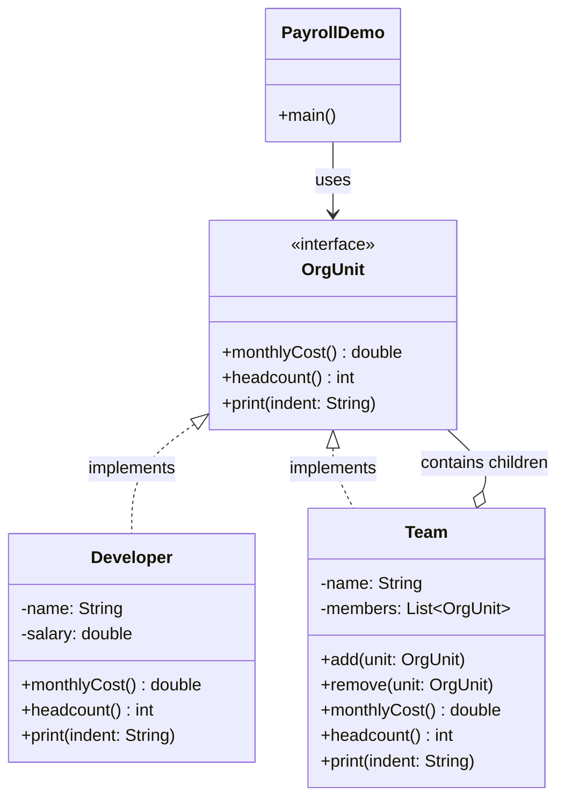
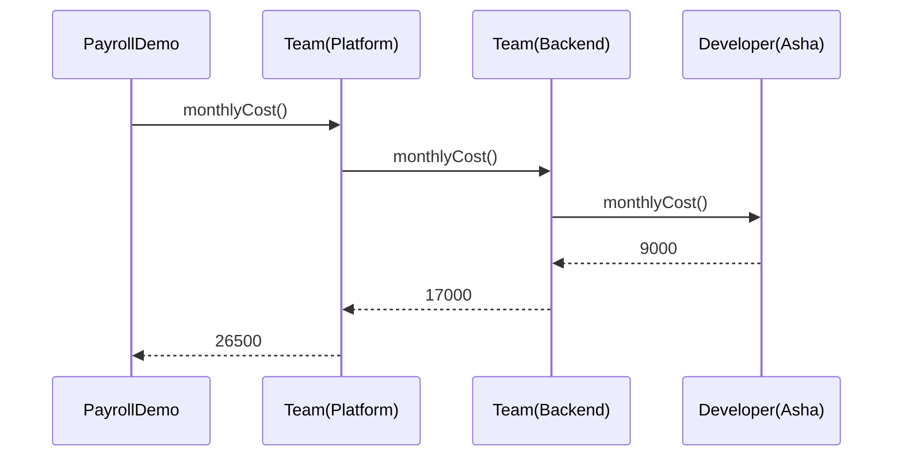

# Composite Design Pattern

## Youtube

- [19. Design File System using Composite Design Pattern | Low Level Design Interview Question | LLD](https://www.youtube.com/watch?v=FLkCkUY7Wu0)

## 1. Overview and Fundamentals

**Intent (GoF):** Compose objects into tree structures to represent part-whole hierarchies. Composite lets clients treat individual objects and compositions uniformly.

**In one line:** One interface for a single thing and a group of things — client code never checks which one it holds.

**Real-world analogy:** A file system. A `File` is a leaf with a size. A `Directory` contains files and other directories. Right-click → Properties shows total size either way — Explorer calls the same operation on both.

**Family context:** Composite is a *structural* pattern. It structures objects into recursive trees while keeping the client decoupled from tree shape.

**Key participants:**

- `Component` — common interface (`FileNode`, `OrgUnit`, `Graphic`) declaring shared operations (`size()`, `draw()`, `monthlyCost()`).
- `Leaf` — single object with no children (`File`, `Developer`, `Circle`).
- `Composite` — holds children of type `Component` and implements operations by delegating/aggregating (`Directory`, `Team`).
- `Client` — uses `Component` uniformly, never `instanceof`-checks leaf vs composite.

**Core characteristics:**

- Recursive composition: composites can nest inside composites to any depth.
- Uniform treatment: one method call works on a leaf or a million-node tree.
- Aggregation semantics: composites typically sum, count, or concatenate child results.
- Child management (`add/remove/getChild`) lives on the composite — or on the component in the transparent variant.
- Natural fit for part-whole domains: files, orgs, menus, UI trees, graphics groups.

**Mental model:**

```text
Component.size()
  Leaf.size() -> own size
  Composite.size() -> sum(child.size() for child in children)
```

If the client should ignore whether it holds one object or a group, use Composite. If wrappers should enrich one object, use Decorator.

## 2. Detailed Theory

**Problem:** Client code becomes littered with type checks: `if (node.isDirectory()) { for (...) } else { ... }`. Every new operation (size, search, print, permissions) duplicates traversal logic. Adding a new node type ripples across all clients.

**Solution:** Define a `Component` interface with the operations clients need. Leaves implement them directly. Composites store a `List<Component>` and implement the same operations by iterating over children. Clients program to `Component` only.

**Transparent vs safe Composite:**

- **Transparent:** `add/remove/getChildren` are declared on `Component` so clients treat everything identically. Cost: leaves must implement meaningless methods (typically throwing `UnsupportedOperationException`). Best when uniformity matters most (UI toolkits).
- **Safe:** Only `Composite` exposes `add/remove`. Leaves stay clean and type-safe. Cost: clients must downcast or know the concrete type to build the tree. Best in statically-typed codebases where leaf purity matters.
- Modern practice favours the **safe** style plus a builder or factory that assembles trees, keeping traversal uniform while construction is explicit.

**Recursive operations and traversal:**

- Operations are naturally recursive: `print()` prints self then calls `child.print(indent+1)`.
- Depth-first is default; breadth-first needs a queue and is still expressed via the component interface.
- Very deep trees risk stack overflow in naive recursion — provide iterative traversal for pathological depths.
- Expensive aggregates (`totalSize`, `headcount`) are O(n) per call; cache them or maintain running totals when reads dominate writes.

**Shared vs exclusive children:**

- Classic Composite gives each child one parent (file system, org chart).
- DAG variants (a file hard-linked into two directories, a shared subtree) allow multiple parents — document ownership and avoid double-counting in aggregates.
- Flyweight leaves (shared glyphs, shared icons) combine naturally: Composite handles structure, Flyweight shares leaf data.

**SOLID connections:**

- **Open/Closed:** New leaf or composite types implement `Component` without touching clients.
- **Liskov Substitution:** Any `Component` substitutes for any other — the heart of the pattern.
- **Single Responsibility:** Each class owns one node's behaviour; traversal is distributed, not centralised.
- **Interface Segregation:** Keep `Component` focused on client-needed queries; push management methods to `Composite` (safe style).

**Consequences:**

- Beautifully simple clients at the cost of generality: it is hard to restrict which children a composite accepts (a `Menu` accepting a `File` compiles but makes no sense).
- Overly generic trees lose type safety; mitigate with generics, validation in `add()`, or separate component sub-interfaces per domain.

## 3. UML and Architecture Diagrams

### Diagram 1 — Class structure (component, leaf, composite)



**Explanation:** `OrgUnit` is the component contract. `Developer` (leaf) implements it with scalar values. `Team` (composite) holds a list of `OrgUnit` — which may be developers *or* sub-teams — and aggregates by looping. The open-diamond `o--` denotes aggregation: a team has members but members can outlive reassignment. `PayrollDemo` depends only on `OrgUnit`, never on concrete classes, so nesting depth is invisible to it.

### Diagram 2 — Recursive call flow (sequence)



**Explanation:** A single `monthlyCost()` call on the root cascades down the tree and bubbles back up as partial sums. The client issues one call and receives one total — it never iterates, never checks types, never knows the depth. The same shape applies to `headcount()`, `print()`, `size()`, or `render()`: delegate down, aggregate up.

## 4. Implementation Examples in Java, Python, and Go

### 4.1 Java (OOP, file system)

**Explanation:** `FileNode` is the component with `size()` and `print()`. `File` is the leaf. `Directory` is the composite holding children and aggregating sizes. `main` builds `root/home/docs` nesting and prints the tree. Compile with `javac CompositeDemo.java && java CompositeDemo`.

```java
import java.util.ArrayList;
import java.util.List;

interface FileNode {
    int size();
    void print(String indent);
}

class File implements FileNode {
    private final String name;
    private final int bytes;
    File(String name, int bytes) { this.name = name; this.bytes = bytes; }
    @Override public int size() { return bytes; }
    @Override public void print(String indent) {
        System.out.println(indent + name + " (" + bytes + "B)");
    }
}

class Directory implements FileNode {
    private final String name;
    private final List<FileNode> children = new ArrayList<>();
    Directory(String name) { this.name = name; }
    public void add(FileNode node) { children.add(node); }
    public void remove(FileNode node) { children.remove(node); }
    @Override public int size() {
        int total = 0;
        for (FileNode c : children) total += c.size();
        return total;
    }
    @Override public void print(String indent) {
        System.out.println(indent + name + "/");
        for (FileNode c : children) c.print(indent + "  ");
    }
}

public class CompositeDemo {
    public static void main(String[] args) {
        Directory root = new Directory("root");
        Directory home = new Directory("home");
        home.add(new File("notes.txt", 120));
        home.add(new File("photo.jpg", 2048));
        Directory docs = new Directory("docs");
        docs.add(new File("resume.pdf", 512));
        home.add(docs);
        root.add(home);
        root.add(new File("readme.md", 64));
        root.print("");
        System.out.println("Total size: " + root.size() + "B");
    }
}
```

**Sample I/O:**

```text
root/
  home/
    notes.txt (120B)
    photo.jpg (2048B)
    docs/
      resume.pdf (512B)
  readme.md (64B)
Total size: 2744B
```

### 4.2 Python (pythonic, PEP 8, duck-typed component)

**Explanation:** An abstract `OrgUnit` defines `monthly_cost`, `headcount`, and `print`. `Developer` is the leaf; `Team` aggregates over a plain list and supports nesting plus removal. The demo builds Backend inside Platform and prints payroll. Run with `python composite_demo.py`.

```python
"""Composite pattern: treat developers and teams uniformly for payroll."""
from abc import ABC, abstractmethod


class OrgUnit(ABC):
    """Component: shared contract for leaves and composites."""

    @abstractmethod
    def monthly_cost(self) -> float:
        ...

    @abstractmethod
    def headcount(self) -> int:
        ...

    @abstractmethod
    def show(self, indent: str = "") -> None:
        ...


class Developer(OrgUnit):
    """Leaf: individual contributor with no reports."""

    def __init__(self, name: str, salary: float) -> None:
        self._name = name
        self._salary = salary

    def monthly_cost(self) -> float:
        return self._salary

    def headcount(self) -> int:
        return 1

    def show(self, indent: str = "") -> None:
        print(f"{indent}- {self._name} (${self._salary:,.0f})")


class Team(OrgUnit):
    """Composite: holds developers and sub-teams."""

    def __init__(self, name: str) -> None:
        self._name = name
        self._members: list[OrgUnit] = []

    def add(self, unit: OrgUnit) -> None:
        self._members.append(unit)

    def remove(self, unit: OrgUnit) -> None:
        self._members.remove(unit)

    def monthly_cost(self) -> float:
        return sum(m.monthly_cost() for m in self._members)

    def headcount(self) -> int:
        return sum(m.headcount() for m in self._members)

    def show(self, indent: str = "") -> None:
        print(f"{indent}+ Team {self._name}")
        for member in self._members:
            member.show(indent + "  ")


if __name__ == "__main__":
    backend = Team("Backend")
    backend.add(Developer("Asha", 9000))
    backend.add(Developer("Ravi", 8000))

    platform = Team("Platform")
    platform.add(backend)
    platform.add(Developer("Mei", 9500))

    platform.show("")
    print(f"Headcount: {platform.headcount()}")
    print(f"Burn: ${platform.monthly_cost():,.0f}")
```

**Sample I/O:**

```text
+ Team Platform
  + Team Backend
    - Asha ($9,000)
    - Ravi ($8,000)
  - Mei ($9,500)
Headcount: 3
Burn: $26,500
```

### 4.3 Go (idiomatic, implicit interface)

**Explanation:** Go interfaces are implicit, so `FileNode` is satisfied by any struct with `Size()` and `Print()`. `File` is the leaf; `Directory` holds `[]FileNode` and aggregates. `main` builds the same tree as the Java example. Run with `go run composite_demo.go`.

```go
package main

import "fmt"

// Component: anything with a size that can print itself.
type FileNode interface {
	Size() int
	Print(indent string)
}

// Leaf: a single file.
type File struct {
	name  string
	bytes int
}

func (f *File) Size() int { return f.bytes }

func (f *File) Print(indent string) {
	fmt.Printf("%s%s (%dB)\n", indent, f.name, f.bytes)
}

// Composite: a directory of files and sub-directories.
type Directory struct {
	name     string
	children []FileNode
}

func (d *Directory) Add(node FileNode) { d.children = append(d.children, node) }

func (d *Directory) Size() int {
	total := 0
	for _, c := range d.children {
		total += c.Size()
	}
	return total
}

func (d *Directory) Print(indent string) {
	fmt.Println(indent + d.name + "/")
	for _, c := range d.children {
		c.Print(indent + "  ")
	}
}

func main() {
	root := &Directory{name: "root"}
	home := &Directory{name: "home"}
	home.Add(&File{name: "notes.txt", bytes: 120})
	home.Add(&File{name: "photo.jpg", bytes: 2048})
	docs := &Directory{name: "docs"}
	docs.Add(&File{name: "resume.pdf", bytes: 512})
	home.Add(docs)
	root.Add(home)
	root.Add(&File{name: "readme.md", bytes: 64})
	root.Print("")
	fmt.Printf("Total size: %dB\n", root.Size())
}
```

**Sample I/O:**

```text
root/
  home/
    notes.txt (120B)
    photo.jpg (2048B)
    docs/
      resume.pdf (512B)
  readme.md (64B)
Total size: 2744B
```

## 5. Real-World Industry Applications

- **File explorers (Windows Explorer, macOS Finder, VS Code tree):** Directories and files share selection, drag-drop, size, and permission operations through one node interface.
- **Frontend frameworks (React, Angular, Vue, DOM):** Every component renders via the same `render()` whether it is a leaf `<input>` or a container `<div>` of children — the virtual DOM diff walks a Composite.
- **Graphics editors (Figma, Illustrator, Canvas):** Groups of shapes rotate, scale, and export as one shape; nested groups recurse identically.
- **Org/HRIS platforms (Workday, BambooHR):** Headcount, payroll, and reporting roll up from individuals through teams to the whole company with one code path.
- **Menu and navigation systems:** Dropdown menus nest submenus and items; keyboard traversal and access-control checks treat both uniformly.
- **Build systems and test runners (Bazel, JUnit suites):** A suite contains tests and sub-suites; `run()` and `report()` aggregate results recursively.
- **Game scene graphs (Unity, Unreal):** `GameObject` transforms propagate to children — moving a vehicle moves its wheels and passengers.

## 6. Practical Use Cases and Scenarios

1. **File sync client:** `upload()`, `checksum()`, and `size()` work on a file or a folder; sync logic never branches on type.
2. **Payroll roll-up:** Finance calls `monthlyCost()` on any `OrgUnit` — person, team, or division — for budgets and forecasts.
3. **UI layout engine:** `measure()` and `draw()` recurse through containers; adding a new widget type needs no layout changes.
4. **Menu permissions:** `visibleFor(role)` aggregates: a submenu is visible if any child is visible; leaves check their own flag.
5. **Test suite runner:** Suites nest suites and cases; `run()` collects pass/fail counts and `report()` prints the tree.
6. **E-commerce categories:** Categories contain products and subcategories; `productCount()` and `search()` recurse uniformly.

## 7. When to Use and When Not to Use

**Use Composite when:**

- You model part-whole hierarchies with arbitrary depth (files, orgs, menus, scenes).
- Clients should treat leaves and groups identically without `instanceof` checks.
- Operations naturally aggregate: sum, count, search, render, validate.
- The tree is built once and traversed often, or structure itself is the domain.

**Do NOT use Composite when:**

- The structure is flat or fixed-depth — a list plus a loop is simpler and clearer.
- Leaf and group operations genuinely differ and forcing one interface creates nonsense methods on both.
- You need strict type constraints on children (only X inside Y) that the pattern cannot express — consider typed builders or separate classes.
- Sharing/multiple-parent semantics dominate — a graph model with explicit edges fits better than a tree.
- Traversal cost on huge trees is unacceptable and cannot be cached — measure first.

## 8. Do's and Don'ts

**Do:**

- Program clients to the `Component` interface exclusively; assert no `instanceof` in client code during review.
- Prefer the safe style: `add/remove` only on composites; keep leaves minimal.
- Validate `add()` (reject nulls, cycles, wrong child types) with clear errors.
- Cache expensive aggregates or maintain running totals when reads dominate writes.
- Guard recursion depth; offer iterative traversal for very deep trees.

**Don't:**

- Don't put child-management methods on leaves just for uniformity — throwing from leaves is a smell.
- Don't allow cycles (a team containing itself) without detection — infinite recursion follows.
- Don't double-count shared children in DAG variants; document ownership semantics.
- Don't leak child-list internals (return live mutable lists) — return copies or unmodifiable views.

| Do | Don't |
|----|-------|
| Aggregate by delegating to children | `instanceof`-branch in every client |
| Validate `add()` and reject cycles | Let a directory contain itself |
| Cache `size()` for hot paths | Recompute million-node totals per request |
| Return unmodifiable child views | Expose the live `children` list |

## 9. Comparison with Other Design Patterns

| Aspect | Composite | Decorator | Flyweight |
|--------|-----------|-----------|-----------|
| **Intent** | Treat one object and groups uniformly in a tree | Add responsibilities to one object dynamically | Share fine-grained objects to save memory |
| **Structure** | One composite holds *many* children | One decorator wraps *exactly one* component | Factory pool holds canonical shared instances |
| **Children role** | Peers aggregated (sum, count, render all) | Single delegate enriched then returned | No children — extrinsic state passed per call |
| **Depth meaning** | Nesting of groups (team in team) | Layers of features (milk + sugar) | N/A — flat pool keyed by intrinsic state |
| **Client view** | Cannot tell leaf from group | Knows it is stacking features | Unaware sharing happens |
| **Example** | Org chart, file system, menu tree | `BufferedInputStream(FileInputStream)` | Glyph pool, `TreeType` forest |
| **Combines with** | Flyweight leaves, Decorator on nodes | Composite nodes (decorate a whole subtree) | Composite trees with shared leaves |

**Composite vs Iterator:** Composite defines the tree; Iterator defines traversal. Expose an iterator over children rather than hard-coding traversal inside every operation.

**Composite vs Visitor:** Visitor centralises operations over a Composite tree. Use Visitor when operations change often but node types are stable; keep operations on nodes when node types change often.

**When to pick which:** Uniform group handling → Composite. Stackable features on one object → Decorator. Memory sharing across millions → Flyweight. New operations over stable nodes → Visitor.

## 10. Interview Preparation

**Q1: What is the Composite pattern and why is it useful?**
It composes objects into trees so clients treat leaves and groups uniformly through a shared component interface. Usefulness: one code path for size, cost, render, or search regardless of depth — e.g., finance calls `monthlyCost()` on a person or a 500-person org identically.

**Q2: Transparent vs safe Composite — which do you prefer?**
Transparent puts `add/remove` on the component for total uniformity but forces leaves to implement meaningless methods. Safe exposes management only on composites, keeping leaves clean at the cost of downcasting during assembly. Prefer safe in typed codebases; use builders to keep assembly ergonomic.

**Q3: How do you prevent cycles and stack overflows?**
Reject self-adds and ancestor-adds in `add()` (track parents or check identity during insertion). Cap depth or switch to iterative traversal with an explicit stack for very deep trees. Test with adversarial nesting (team containing itself, 100k-deep chain).

**Q4: Where does aggregation logic live?**
In the composite, by delegating to children and combining results (sum for cost, AND/OR for permissions, concatenation for rendering). Leaves return base values. Never put aggregation in clients — that reintroduces the type checks the pattern removes.

**Q5: How do you restrict which children a composite accepts?**
Validate in `add()`: reject nulls, wrong types, or policy violations with descriptive exceptions. Use generics (`Team<Engineer>`) or separate component sub-interfaces when domains need it. Document constraints — the pattern itself cannot express them structurally.

**Q6: How does Composite relate to File, DOM, and UI frameworks?**
All are canonical instances: file systems (files/directories), DOM (elements containing elements), React trees (components containing components). Each exposes uniform operations (`size`, `render`, `querySelector`) that recurse — interviewers expect at least one of these examples.

**Q7: Composite vs Decorator — they both nest, so what differs?**
Composite holds many children and aggregates across peers; Decorator wraps exactly one object and enriches it. Depth in Composite means group nesting; depth in Decorator means feature layers. A group of shapes is Composite; a shape with border plus shadow wrappers is Decorator.

**Q8: What are the performance and memory trade-offs?**
Traversal is O(n) per aggregate; cache totals or maintain running counts for hot paths. Memory overhead is one child list per composite plus parent pointers if needed. For millions of leaves, combine with Flyweight (share leaf data) and avoid storing redundant parent/child duplicates.

**LLD Scenario 1 — File system with size and search:** Design `FileNode` with `size()`, `search(keyword)`, `print()`. `Directory` aggregates. Discuss permission checks, symlink cycles, and caching sizes. Expected: component interface, safe composite, cycle rejection, running totals or memoisation.

**LLD Scenario 2 — Org chart with payroll and reporting chain:** Design `OrgUnit` with `monthlyCost()`, `headcount()`, `findByName()`. Support teams in teams, contractors vs FTE leaves, and moving members between teams. Expected: leaf variants, composite moves, uniform queries, removal semantics.

**LLD Scenario 3 — Nested comment thread with voting:** Comments contain replies to arbitrary depth; `score()` sums subtree votes; `render()` indents. Discuss collapsing, pagination of children, and depth limits. Expected: composite with lazy-loaded children, score aggregation, traversal caps.

## 11. Testing and Best Practices

**Unit tests:**

- Test leaves alone: `Developer` returns own salary, headcount 1; `File` returns own bytes.
- Test composites: empty team (cost 0, headcount 0), flat team, 3-level nesting — verify sums and traversal order.
- Test management: `add/remove`, removing absent child, rejecting nulls and cycles.
- Assert client uniformity: same client function produces correct results for leaf and composite inputs without branching.

**Integration and property tests:**

- Build randomised trees and compare recursive vs iterative traversal results.
- Load-test deep/wide trees for stack and time behaviour; set documented depth limits.
- For permission composites, matrix-test role x tree-shape visibility outcomes.

**Best practices:**

- Return unmodifiable views of children; mutate only via `add/remove` with validation.
- Keep components immutable where possible; rebuild subtrees instead of mutating shared nodes.
- Maintain running totals for hot aggregates; invalidate on `add/remove`.
- Combine with Iterator for traversal and Visitor for pluggable operations as the design matures.

| Aspect | Impact |
|--------|--------|
| **Memory** | Medium (one child list per composite; parent pointers optional) |
| **Runtime cost** | Medium (O(n) traversal per aggregate; cache when hot) |
| **Scalability** | Medium (fine for thousands of nodes; pair with Flyweight for millions) |
| **Risk** | Cycles and over-general types — validate `add()`, bound depth |

## 12. Summary and Key Takeaways

- **Composite = uniform trees:** One interface for leaves and groups; clients never branch on type.
- **Prefer safe over transparent:** Management methods belong on composites, not leaves.
- **Aggregate inside composites:** Sum, count, and render recurse naturally — never in clients.
- **Guard the tree:** Reject nulls and cycles, bound depth, and return unmodifiable child views.
- **Cache hot aggregates** when reads dominate; use iterative traversal for extreme depths.
- **Distinguish neighbours:** Groups → Composite; stacked features → Decorator; shared instances → Flyweight; traversal abstraction → Iterator; pluggable operations → Visitor.
- **Test shapes, not just values:** Empty, flat, nested, cyclic-rejected, and randomised trees.
