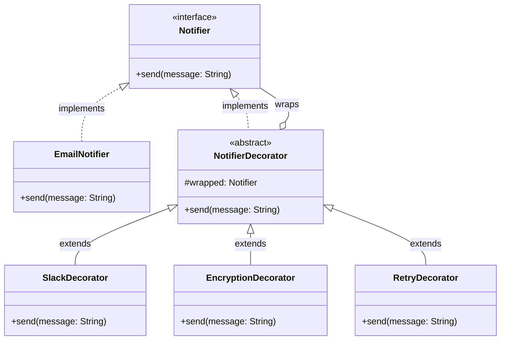
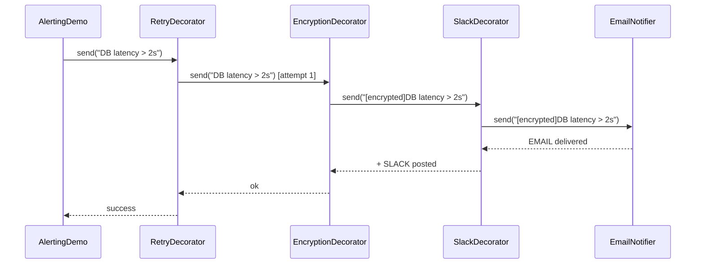

# Decorator Design Pattern

## Youtube

- [4. Decorator Design Pattern Explanation with Java Coding (Hindi) | LLD System Design](https://www.youtube.com/watch?v=w6a9MXUwcfY)

## 1. Overview and Fundamentals

**Intent (GoF):** Attach additional responsibilities to an object dynamically. Decorators provide a flexible alternative to subclassing for extending functionality.

**In one line:** Wrap an object in layers — each layer adds one feature while staying interchangeable with the original.

**Real-world analogy:** Coffee shop condiments. Base `Espresso` costs $2. Add `Milk` (+$0.50), `Sugar` (+$0.20), `WhippedCream` (+$0.70). Each condiment wraps the previous drink, the final object is still a `Coffee`, and any combination is possible without a `MilkySugaryWhippedEspresso` subclass.

**Family context:** Decorator is a *structural* pattern. It changes the skin and behaviour of objects through composition rather than inheritance hierarchies.

**Key participants:**

- `Component` — common interface (`Coffee`, `Notifier`, `InputStream`).
- `ConcreteComponent` — base object with default behaviour (`BasicCoffee`, `EmailNotifier`).
- `Decorator` — abstract wrapper holding a `Component` reference and delegating by default.
- `ConcreteDecorator` — adds one responsibility (`MilkDecorator`, `EncryptionDecorator`, `BufferedInputStream`).

**Core characteristics:**

- Same interface at every layer — a decorated object substitutes anywhere the original fits.
- Composition at runtime: `new Retry(new Encrypt(new Slack(new Email())))`.
- Each decorator has a single responsibility; features mix and match.
- Order can matter: encrypt-then-log differs from log-then-encrypt.
- Alternative to subclass explosion: N optional features need N decorators, not 2^N subclasses.

**Mental model:**

```text
Client -> RetryDecorator -> EncryptionDecorator -> SlackDecorator -> EmailNotifier
  send()      retries          encrypts              also posts       base send
```

If the caller deliberately stacks toppings, it is a Decorator. If the wrapper secretly guards or defers, it is a Proxy.

## 2. Detailed Theory

**Problem:** Subclassing for every feature combination explodes. Three boolean options (milk, sugar, foam) already need 8 subclasses; adding caramel doubles to 16. Static inheritance also locks behaviour at compile time — you cannot add or remove a topping per request.

**Solution:** Define a `Component` interface. Implement the base behaviour once. For each optional feature, write a `Decorator` that implements the same interface, holds a wrapped `Component`, delegates the core call, and adds its own logic before or after delegation.

**How delegation works:**

- **Transparent delegation:** `NotifierDecorator.send()` calls `wrapped.send()` by default so subclasses override only what they change.
- **Before-advice:** Validate, transform, or enrich input (encrypt message, check args) then delegate.
- **After-advice:** Enrich output or side effects (also post to Slack, record metrics) after delegating.
- **Around-advice:** Retry, caching, or timing wraps the delegate call in try/catch or clock logic.
- **Recursive unwrapping:** Because every layer honours the interface, depth is invisible to clients.

**Ordering semantics:**

- Order is part of the configuration. `Encrypt(Slack(Email))` encrypts once then fans out; `Slack(Encrypt(Email))` may double-encrypt or leak plaintext to logs.
- Document valid orderings; provide factory methods for blessed stacks (`AlertingPipelines.critical()`).
- When order must not matter, design decorators to be commutative (idempotent headers, independent side channels).

**Decorator vs inheritance vs composition helpers:**

- **Inheritance:** Compile-time, rigid, exponential class growth.
- **Decorator:** Runtime, flexible, linear class growth, but longer construction expressions and deeper stack traces.
- **Builder/Factory:** Often paired to tame construction — `NotifierBuilder.withSlack().withRetry().build()` hides nesting.
- **Middleware pipelines (Express, Django, gRPC interceptors):** Framework-level decorators where each handler wraps the next — same pattern at architectural scale.

**SOLID connections:**

- **Open/Closed:** New behaviour arrives as a new wrapper; existing components never change.
- **Single Responsibility:** Each decorator owns one concern (encryption, retry, fan-out).
- **Liskov Substitution:** Any decorated object substitutes for the base component.
- **Dependency Inversion:** Clients depend on `Notifier`, not on any concrete decorator.

**Consequences:**

- Maximum combinability at the cost of many small objects and harder debugging through long chains.
- `instanceof` checks break — a decorated `EmailNotifier` is not an `EmailNotifier` instance in the naive sense.
- Deep chains add per-call overhead; fuse hot paths or cache when profiling demands it.

## 3. UML and Architecture Diagrams

### Diagram 1 — Class structure (stacked wrappers)



**Explanation:** `EmailNotifier` is the concrete component. `NotifierDecorator` implements the same `Notifier` interface and holds a wrapped `Notifier` (aggregation). Each concrete decorator extends the base decorator and overrides `send()` to add its bit before or after delegating. Because decorators and components share the interface, they nest arbitrarily: a `RetryDecorator` can wrap an `EncryptionDecorator` that wraps a `SlackDecorator` that wraps the email base.

### Diagram 2 — Runtime stacking (sequence)



**Explanation:** The call flows inward through the stack, each layer transforming or fanning out, then results propagate outward. Encryption happens before fan-out so both email and Slack see ciphertext. Retry surrounds everything, so a failure at any inner layer triggers a full-stack retry. Reordering the nesting would visibly change this trace — which is why order is configuration.

## 4. Implementation Examples in Java, Python, and Go

### 4.1 Java (OOP, notifier pipeline)

**Explanation:** `EmailNotifier` is the base. `NotifierDecorator` delegates by default. `SlackDecorator`, `EncryptionDecorator`, and `RetryDecorator` each add one behaviour. `AlertingDemo` composes the full pipeline in one nested expression. Compile with `javac DecoratorDemo.java && java AlertingDemo`.

```java
interface Notifier {
    void send(String message);
}

class EmailNotifier implements Notifier {
    @Override
    public void send(String message) {
        System.out.println("EMAIL: " + message);
    }
}

abstract class NotifierDecorator implements Notifier {
    protected final Notifier wrapped;
    protected NotifierDecorator(Notifier wrapped) { this.wrapped = wrapped; }
    @Override
    public void send(String message) { wrapped.send(message); }
}

class SlackDecorator extends NotifierDecorator {
    SlackDecorator(Notifier wrapped) { super(wrapped); }
    @Override
    public void send(String message) {
        super.send(message);
        System.out.println("SLACK: " + message);
    }
}

class EncryptionDecorator extends NotifierDecorator {
    EncryptionDecorator(Notifier wrapped) { super(wrapped); }
    @Override
    public void send(String message) {
        super.send("[encrypted]" + message);
    }
}

class RetryDecorator extends NotifierDecorator {
    RetryDecorator(Notifier wrapped) { super(wrapped); }
    @Override
    public void send(String message) {
        int attempts = 0;
        while (true) {
            try {
                super.send(message);
                return;
            } catch (RuntimeException e) {
                if (++attempts >= 3) throw e;
                System.out.println("Retrying... attempt " + (attempts + 1));
            }
        }
    }
}

class AlertingDemo {
    public static void main(String[] args) {
        Notifier pipeline = new RetryDecorator(
            new EncryptionDecorator(
                new SlackDecorator(new EmailNotifier())));
        pipeline.send("DB latency above 2s");

        System.out.println("--- plain ---");
        new EmailNotifier().send("plain hello");
    }
}
```

**Sample I/O:**

```text
EMAIL: [encrypted]DB latency above 2s
SLACK: [encrypted]DB latency above 2s
--- plain ---
EMAIL: plain hello
```

### 4.2 Python (pythonic, PEP 8, callable wrappers)

**Explanation:** Python's first-class functions make decorators natural, but for LLD parity we use classes sharing a `Notifier` protocol. Each wrapper stores the inner notifier and delegates. The demo also shows Python's `@` syntax alternative in comments. Run with `python decorator_demo.py`.

```python
"""Decorator pattern: stack Slack, encryption, and retry around email."""
from abc import ABC, abstractmethod


class Notifier(ABC):
    """Component: minimal notification contract."""

    @abstractmethod
    def send(self, message: str) -> None:
        ...


class EmailNotifier(Notifier):
    """Concrete component: plain email delivery."""

    def send(self, message: str) -> None:
        print(f"EMAIL: {message}")


class NotifierDecorator(Notifier):
    """Base decorator: delegates by default."""

    def __init__(self, wrapped: Notifier) -> None:
        self._wrapped = wrapped

    def send(self, message: str) -> None:
        self._wrapped.send(message)


class SlackDecorator(NotifierDecorator):
    """Also posts to Slack after delegating."""

    def send(self, message: str) -> None:
        super().send(message)
        print(f"SLACK: {message}")


class EncryptionDecorator(NotifierDecorator):
    """Encrypts before delegating."""

    def send(self, message: str) -> None:
        super().send(f"[encrypted]{message}")


class RetryDecorator(NotifierDecorator):
    """Retries the whole inner chain up to 3 times."""

    def send(self, message: str) -> None:
        attempts = 0
        while True:
            try:
                super().send(message)
                return
            except RuntimeError:
                attempts += 1
                if attempts >= 3:
                    raise
                print(f"Retrying... attempt {attempts + 1}")


if __name__ == "__main__":
    pipeline: Notifier = RetryDecorator(
        EncryptionDecorator(SlackDecorator(EmailNotifier()))
    )
    pipeline.send("DB latency above 2s")
    print("--- plain ---")
    EmailNotifier().send("plain hello")
```

**Sample I/O:**

```text
EMAIL: [encrypted]DB latency above 2s
SLACK: [encrypted]DB latency above 2s
--- plain ---
EMAIL: plain hello
```

### 4.3 Go (idiomatic, struct embedding via interface field)

**Explanation:** Go has no inheritance, so each decorator is a struct holding a `Notifier` interface value. Methods delegate explicitly. Construction nests struct literals. Run with `go run decorator_demo.go`.

```go
package main

import "fmt"

// Component.
type Notifier interface {
	Send(message string)
}

// Concrete component.
type EmailNotifier struct{}

func (e *EmailNotifier) Send(message string) {
	fmt.Println("EMAIL: " + message)
}

// Concrete decorator: also posts to Slack.
type SlackDecorator struct {
	wrapped Notifier
}

func (d *SlackDecorator) Send(message string) {
	d.wrapped.Send(message)
	fmt.Println("SLACK: " + message)
}

// Concrete decorator: encrypts before delegating.
type EncryptionDecorator struct {
	wrapped Notifier
}

func (d *EncryptionDecorator) Send(message string) {
	d.wrapped.Send("[encrypted]" + message)
}

// Concrete decorator: retries inner chain.
type RetryDecorator struct {
	wrapped Notifier
}

func (d *RetryDecorator) Send(message string) {
	for attempt := 1; attempt <= 3; attempt++ {
		func() {
			defer func() {
				if r := recover(); r != nil && attempt == 3 {
					panic(r)
				}
			}()
			d.wrapped.Send(message)
			attempt = 4 // success: break loop
		}()
	}
}

func main() {
	var pipeline Notifier = &RetryDecorator{
		wrapped: &EncryptionDecorator{
			wrapped: &SlackDecorator{wrapped: &EmailNotifier{}},
		},
	}
	pipeline.Send("DB latency above 2s")
	fmt.Println("--- plain ---")
	(&EmailNotifier{}).Send("plain hello")
}
```

**Sample I/O:**

```text
EMAIL: [encrypted]DB latency above 2s
SLACK: [encrypted]DB latency above 2s
--- plain ---
EMAIL: plain hello
```

## 5. Real-World Industry Applications

- **Java I/O (`BufferedInputStream`, `GZIPInputStream`, `DataInputStream`):** The canonical textbook stack — buffering, decompression, and typed reads layer over any `InputStream` in any order.
- **HTTP middleware (Express, Django, Spring interceptors, gRPC):** Authentication, logging, CORS, rate-limiting, and compression each wrap the next handler — a framework-scale decorator chain.
- **Spring annotations (`@Transactional`, `@Cacheable`, `@Retryable`):** AOP proxies decorate bean methods with transactions, caching, and retries without touching business code.
- **OkHttp / Python `requests` interceptors:** Retry, auth-header injection, logging, and metrics wrap a base HTTP client per request.
- **UI adornments:** Scrollbars, borders, shadows, and tooltips wrap base widgets in Swing, JavaFX, and web component libraries.
- **Coffee/pizza configurators (Starbucks, Domino's apps):** Toppings and size upgrades stack price and description dynamically — the domain that named the pattern.

## 6. Practical Use Cases and Scenarios

1. **Alerting pipeline:** Base email plus optional Slack, PagerDuty, encryption, and retry — composed per severity (`critical = all layers`, `info = email only`).
2. **Payment processing:** Base charge wrapped with fraud-check, idempotency, currency conversion, and audit logging decorators chosen per region.
3. **File stream stack:** `DataInputStream(BufferedInputStream(GZIPInputStream(FileInputStream)))` — buffering, decompression, typed reads in one line.
4. **API client hardening:** Base HTTP client decorated with retry, circuit-breaker, auth-refresh, and metrics for production while tests use the bare client.
5. **Text editor formatting:** Base text wrapped with bold, italic, hyperlink, and mention decorators for rich rendering.
6. **Data pipeline:** Base reader decorated with validation, deduplication, enrichment, and sampling stages toggled by feature flags.

## 7. When to Use and When Not to Use

**Use Decorator when:**

- You need optional, combinable responsibilities chosen at runtime.
- Subclassing would explode (N features → 2^N subclasses).
- Responsibilities should be added or removed per object, not per class.
- You want Open/Closed extension: new feature = new wrapper, zero edits.
- Each feature is independently testable and order-explicit.

**Do NOT use Decorator when:**

- Features are fixed and universal — bake them into the base class instead.
- Only one combination will ever exist — a single subclass or direct composition is simpler.
- Order-independence cannot be guaranteed and every permutation behaves differently — consider a pipeline with explicit stages or Chain of Responsibility.
- Performance-critical hot paths cannot afford per-layer delegation — fuse or inline after profiling.
- The wrapper must control access or lifecycle rather than add features — that is Proxy.

## 8. Do's and Don'ts

**Do:**

- Keep each decorator focused on exactly one responsibility.
- Delegate faithfully: forward all interface methods, not just the convenient one.
- Document ordering constraints and provide factory methods for blessed stacks.
- Favour constructor injection of the wrapped component for testability.
- Test each decorator in isolation plus representative compositions.

**Don't:**

- Don't let decorators depend on each other directly — they should only know the component interface.
- Don't use `instanceof`/type-switches to peek through layers — that defeats substitutability.
- Don't accumulate business rules across layers opaquely — order bugs become undebuggable.
- Don't build 10-deep chains on hot paths without profiling delegation cost.
- Don't expose unwrapping backdoors that let clients bypass layers.

| Do | Don't |
|----|-------|
| `new Retry(new Encrypt(new Slack(email)))` explicit | Hidden global mutation inside decorators |
| One concern per decorator, tested alone | God decorator doing auth + retry + logging |
| Factory for standard stacks | Force every caller to nest 5 constructors |
| Document encrypt-before-log | Log plaintext then encrypt (leak) |

## 9. Comparison with Other Design Patterns

| Aspect | Decorator | Proxy | Composite | Adapter |
|--------|-----------|-------|-----------|---------|
| **Intent** | Add responsibilities dynamically, client-composed | Control access (guard, defer, cache), often transparent | Treat one and many uniformly in a tree | Convert incompatible interface |
| **Interface** | Same as component; stacking normal | Same as subject; usually single layer | Same for leaf and group | Changes to target interface |
| **Who builds** | Client nests wrappers explicitly | Framework/factory hides proxy | Client assembles tree | Client uses target, adapter hidden |
| **Cardinality** | One decorator wraps exactly one component | One proxy fronts one subject | One composite holds many children | One adapter bridges one adaptee |
| **Lifecycle** | Never manages wrapped lifecycle | May create/cache/synchronise real object | Manages children collection | Stateless translator |
| **Example** | `EncryptionDecorator(Notifier)` | `AccountProtectionProxy` | `Team` of `Developer`s | `StripeAdapter` |
| **Without it** | 2^N subclasses | Scattered guards / eager cost | Type-check soup | Code does not compile |

**Decorator vs Chain of Responsibility:** Decorator always delegates through the full stack; CoR passes along until one handler consumes the request. Decorator enriches; CoR dispatches.

**When to pick which:** Stackable opt-in features → Decorator. Guard/defer/cache transparently → Proxy. One-or-many uniformity → Composite. Signature mismatch → Adapter.

## 10. Interview Preparation

**Q1: What is Decorator and why prefer it over subclassing?**
Decorator wraps an object in layers sharing its interface, adding one responsibility per layer at runtime. N optional features need N decorators instead of 2^N subclasses, behaviour composes per object rather than per class, and new features arrive without editing existing code.

**Q2: How do Java I/O streams demonstrate Decorator?**
`FileInputStream` is the component; `BufferedInputStream`, `GZIPInputStream`, `DataInputStream` are decorators wrapping any `InputStream`. Nesting them stacks buffering, decompression, and typed reads in any order while downstream code sees only `InputStream`.

**Q3: Decorator vs Proxy — both wrap, so what differs?**
Decorator openly adds features the client composes (`and also`); Proxy controls access on the client's behalf (`you may not / not yet`), often invisibly. Decorators stack many-deep by hand; proxies are usually single-layer and may manage the real object's lifecycle.

**Q4: What goes wrong with deep or misordered chains?**
Deep chains add delegation overhead and long stack traces. Misordering causes semantic bugs: logging before encryption leaks plaintext; retrying inside encryption may resend ciphertext incorrectly. Mitigate with documented orderings, factory-built standard stacks, and integration tests per supported ordering.

**Q5: How do middleware pipelines relate to Decorator?**
Express/Django middleware, Spring interceptors, and gRPC interceptors are Decorator at framework scale: each handler wraps the next, adding auth, logging, or compression. The request flows inward through layers exactly like `send()` flows through notifier decorators.

**Q6: How do you keep construction manageable?**
Provide builders or factory methods (`AlertPipelines.critical()`) returning blessed stacks. Use DI to wire common stacks. Keep decorator constructors to one wrapped-component parameter plus its own config.

**Q7: Why do `instanceof` checks break with Decorator?**
A wrapped object reports the decorator's type, not the inner component's. Code that branches on concrete type fails. Solution: program to the interface and expose capability queries on the interface if needed, never downcast through layers.

**Q8: What is the performance cost?**
One virtual call per layer — negligible for I/O-bound work, measurable for nanosecond hot loops. Profile before fusing. Prefer shallow chains on hot paths; keep deep stacks for configuration-heavy, I/O-bound pipelines.

**LLD Scenario 1 — Coffee shop pricing engine:** Design `Beverage` with `cost()` and `description()`. Implement `Espresso`, `Milk`, `Sugar`, `Whip` decorators. Support arbitrary nesting, combo discounts, and receipt printing. Expected: component interface, per-topping decorators, order-independent pricing, builder for common drinks.

**LLD Scenario 2 — HTTP client with retry/auth/metrics:** Base `HttpClient` plus `AuthDecorator` (token refresh), `RetryDecorator` (exponential backoff), `MetricsDecorator` (latency histograms). Discuss ordering (auth inside or outside retry?) and testability. Expected: decorator stack, ordering rationale, per-layer unit tests with stubbed inner client.

**LLD Scenario 3 — Notification fan-out with encryption:** Base email plus Slack, SMS, encryption, and rate-limit decorators. Critical alerts use all layers; info uses email only. Discuss where truncation lives and how to avoid plaintext logs. Expected: stack composition per severity, encrypt-before-log ordering, factory wiring.

## 11. Testing and Best Practices

**Unit tests:**

- Test each decorator against a stub component: assert transformation happens exactly once and delegation happens exactly once (mock verification).
- Test `RetryDecorator` with a failing stub: assert 3 attempts then success, and 3 attempts then rethrow.
- Test order-sensitive pairs both ways (`Encrypt(Log(x))` vs `Log(Encrypt(x))`) and lock the correct one.
- Test the base component alone to prove it works undecorated.

**Integration tests:**

- Representative full stacks (email + Slack + encryption + retry) with fake transports.
- Concurrency tests when decorators hold state (rate limiters, circuit breakers) — assert thread-safety.
- Performance smoke test on deepest supported chain to bound latency.

**Best practices:**

- Keep decorators stateless where possible; isolate mutable state (counters, caches) with clear thread-safety docs.
- Forward `equals/hashCode/toString` thoughtfully or document that identity is layered.
- Provide `unwrap()` only for diagnostics, never for bypassing in production paths.
- Combine with Builder for ergonomic construction and with Strategy inside decorators when the added behaviour itself varies.

| Aspect | Impact |
|--------|--------|
| **Memory** | Medium (one object per layer) |
| **Runtime cost** | Medium (one delegation per layer; negligible for I/O) |
| **Scalability** | Medium (chains compose linearly; watch depth on hot paths) |
| **Risk** | Order bugs and debug complexity — document and factory-build stacks |

## 12. Summary and Key Takeaways

- **Decorator = stackable features:** Same interface, one responsibility per layer, composed at runtime.
- **N decorators beat 2^N subclasses** — linear growth, per-object configurability, Open/Closed extension.
- **Order is configuration:** Document it, factory-build blessed stacks, test each supported ordering.
- **Delegate faithfully:** Forward the full interface; never peek through layers with type checks.
- **Distinguish neighbours:** Stacked features → Decorator; guarded access → Proxy; group uniformity → Composite; signature fix → Adapter; consumed handler → Chain of Responsibility.
- **Test layers then stacks:** Isolated decorator tests plus integration tests for real compositions.
