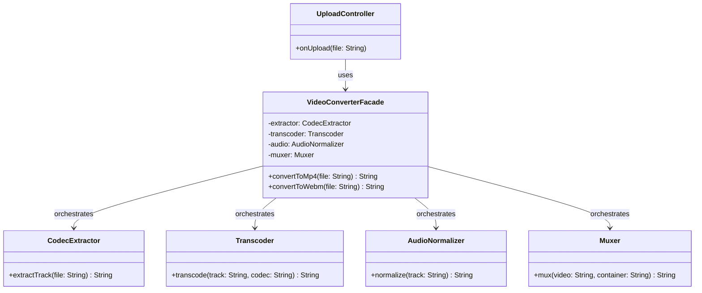
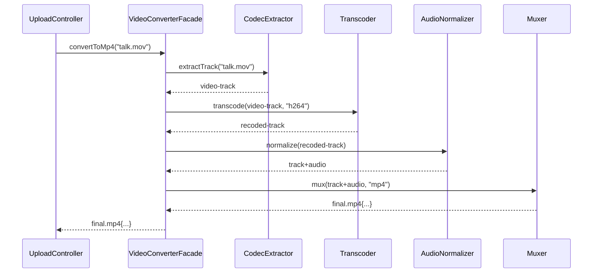

# Facade Design Pattern

## Youtube

- [25. Facade Design Pattern with Example | Facade Low Level Design Pattern | Facade Pattern LLD Java](https://www.youtube.com/watch?v=GYaBXK54eLo)

## 1. Overview and Fundamentals

**Intent (GoF):** Provide a unified interface to a set of interfaces in a subsystem. Facade defines a higher-level interface that makes the subsystem easier to use.

**In one line:** One simple front door hiding a building full of complicated rooms.

**Real-world analogy:** A hotel concierge. You say "book a cab, reserve dinner, arrange checkout". The concierge coordinates taxi dispatch, restaurant booking, and billing subsystems. You never call each department yourself.

**Family context:** Facade is a *structural* pattern. It structures access to a subsystem rather than changing signatures (Adapter) or adding features (Decorator).

**Key participants:**

- `Facade` — simplified entry point exposing coarse-grained operations (`OrderFacade.placeOrder()`, `VideoConverterFacade.convertToMp4()`).
- `Subsystem classes` — do the real work, remain independently usable (`PaymentService`, `InventoryService`, `CodecExtractor`, `Muxer`).
- `Client` — calls only the facade for common flows; may drop down to subsystem for advanced needs.

**Core characteristics:**

- Orchestrates call order: validate → charge → reserve → ship.
- Does not encapsulate the subsystem — internals stay public for power users.
- Typically stateless coordination; holds subsystem references via composition.
- One facade per use case or subsystem view is normal (`CheckoutFacade`, `VideoConverterFacade`, `ThumbnailFacade`).
- Reduces coupling: client depends on 1 facade instead of N subsystem classes.

**Mental model:**

```text
Client -> Facade.placeOrder()
            |-> payments.charge()
            |-> stock.reserve()
            |-> shipping.dispatch()
```

If the pain is "too many steps in the right order", write a Facade. If the pain is "signatures don't match", write an Adapter.

## 2. Detailed Theory

**Problem:** A subsystem is powerful but painful: video conversion needs extract → transcode → normalise → mux in exact order with correct options. Checkout needs payment, inventory, shipping, notification, and audit calls. Every caller copy-pastes the sequence, gets ordering wrong, and breaks when a subsystem changes.

**Solution:** Introduce a Facade that owns the workflow. It exposes intention-revealing methods (`convertToMp4(file)`, `placeOrder(order)`) and internally wires subsystem calls, default options, error translation, and ordering. Callers go from 15 lines to 1.

**Facade vs layers and gateways:**

- **Facade object:** In-process simplifier over a library or module (this pattern).
- **Layered subsystem:** Facade often marks a layer boundary — UI calls service facade, which calls repositories.
- **API Gateway / BFF:** Distributed cousin — one HTTP endpoint orchestrating many microservices, same intent at network scale.
- **Anti-corruption layer:** Facade plus translation; pure Facade does not translate types, it only orchestrates.

**Design choices:**

- **Thin vs rich facade:** Thin facades only sequence calls; rich facades add defaults, retries, and transaction boundaries. Prefer thin; push business rules into domain services.
- **One vs many facades:** Start with one per subsystem; split by client need when it grows (`AdminFacade` vs `CustomerFacade`). A single god facade that knows everything is the classic failure mode.
- **Return types:** Return subsystem types or simple DTOs — do not rewrap the world. Let callers drill down when needed.
- **Error handling:** Translate low-level exceptions (`CodecException`, `SQLException`) into facade-level errors (`ConversionFailed`, `OrderFailed`) with causes preserved.
- **State:** Keep facades stateless; pass context as parameters so they stay thread-safe and testable.

**SOLID connections:**

- **Single Responsibility:** Each facade owns one workflow or view, not all workflows.
- **Dependency Inversion:** Clients depend on facade abstraction; facade depends on subsystem abstractions (inject for testability).
- **Open/Closed:** New workflows arrive as new facade methods or new facades, not by editing subsystem classes.
- **Interface Segregation:** Client-specific facades expose only what each client needs.

**Consequences:**

- Dramatically simpler happy paths at the cost of a potential god object and a hiding place for complexity.
- Well-designed facades are optional — experts can bypass them. Bad facades trap everyone behind a lowest-common-denominator API.

## 3. UML and Architecture Diagrams

### Diagram 1 — Class structure (facade over subsystem)



**Explanation:** The client (`UploadController`) has exactly one dependency: the facade. The facade holds references to four subsystem classes and encodes the correct pipeline order. Subsystem classes know nothing about the facade, so power users can still call `Transcoder` directly with custom bitrates. Adding a new output format is a new facade method, not a client change.

### Diagram 2 — Orchestration flow (sequence)



**Explanation:** The sequence makes the value obvious: five subsystem interactions collapse into one client call. Ordering lives in exactly one place — extract before transcode before mux. Error translation also lives here: if `Transcoder` throws a codec error, the facade wraps it in a `ConversionFailed` with the filename attached, so controllers never import codec internals.

## 4. Implementation Examples in Java, Python, and Go

### 4.1 Java (OOP, video conversion facade)

**Explanation:** Four subsystem classes do one job each. `VideoConverterFacade` wires them with sensible defaults. `UploadController` calls one method. Compile with `javac FacadeDemo.java && java FacadeDemo`.

```java
class CodecExtractor {
    String extractTrack(String file) { return "video-track-of:" + file; }
}

class Transcoder {
    String transcode(String track, String codec) { return track + "->" + codec; }
}

class AudioNormalizer {
    String normalize(String track) { return track + "+normalized-audio"; }
}

class Muxer {
    String mux(String video, String container) {
        return "final." + container + "{" + video + "}";
    }
}

class VideoConverterFacade {
    private final CodecExtractor extractor = new CodecExtractor();
    private final Transcoder transcoder = new Transcoder();
    private final AudioNormalizer audio = new AudioNormalizer();
    private final Muxer muxer = new Muxer();

    public String convertToMp4(String sourceFile) {
        String track = extractor.extractTrack(sourceFile);
        String recoded = transcoder.transcode(track, "h264");
        return muxer.mux(audio.normalize(recoded), "mp4");
    }

    public String convertToWebm(String sourceFile) {
        String track = extractor.extractTrack(sourceFile);
        String recoded = transcoder.transcode(track, "vp9");
        return muxer.mux(audio.normalize(recoded), "webm");
    }
}

class UploadController {
    private final VideoConverterFacade videos = new VideoConverterFacade();
    void onUpload(String file) {
        System.out.println("Ready to stream: " + videos.convertToMp4(file));
    }
}

public class FacadeDemo {
    public static void main(String[] args) {
        new UploadController().onUpload("talk.mov");
    }
}
```

**Sample I/O:**

```text
Ready to stream: final.mp4{video-track-of:talk.mov->h264+normalized-audio}
```

### 4.2 Python (pythonic, PEP 8, order checkout facade)

**Explanation:** `OrderFacade` coordinates payment, inventory, and shipping services behind `place_order()`. Subsystem classes stay usable alone. Dependency injection via constructor keeps tests hermetic. Run with `python facade_demo.py`.

```python
"""Facade pattern: one checkout call hiding payment, stock, shipping."""


class PaymentService:
    def charge(self, order_id: str, amount: float) -> str:
        return f"charge:{order_id}:{amount:.2f}"


class InventoryService:
    def reserve(self, order_id: str, sku: str) -> str:
        return f"reserved:{sku}-for-{order_id}"


class ShippingService:
    def dispatch(self, order_id: str, address: str) -> str:
        return f"shipped:{order_id}-to-{address}"


class NotificationService:
    def notify(self, order_id: str) -> str:
        return f"notified:{order_id}"


class OrderFacade:
    """Simplified checkout entry point."""

    def __init__(self) -> None:
        self._payments = PaymentService()
        self._stock = InventoryService()
        self._shipping = ShippingService()
        self._notify = NotificationService()

    def place_order(self, order_id: str, sku: str,
                    amount: float, address: str) -> str:
        receipt = self._payments.charge(order_id, amount)
        reservation = self._stock.reserve(order_id, sku)
        shipment = self._shipping.dispatch(order_id, address)
        self._notify.notify(order_id)
        return f"OK {receipt} | {reservation} | {shipment}"


if __name__ == "__main__":
    facade = OrderFacade()
    print(facade.place_order("ord-101", "keyboard", 2499.0, "Bengaluru"))
```

**Sample I/O:**

```text
OK charge:ord-101:2499.00 | reserved:keyboard-for-ord-101 | shipped:ord-101-to-Bengaluru
```

### 4.3 Go (idiomatic, explicit struct wiring)

**Explanation:** Same checkout domain in Go. Subsystems are structs with methods; `OrderFacade` holds them and exposes `PlaceOrder`. No hidden globals — wiring is visible in `NewOrderFacade`. Run with `go run facade_demo.go`.

```go
package main

import "fmt"

type PaymentService struct{}

func (p *PaymentService) Charge(orderID string, amount float64) string {
	return fmt.Sprintf("charge:%s:%.2f", orderID, amount)
}

type InventoryService struct{}

func (s *InventoryService) Reserve(orderID, sku string) string {
	return fmt.Sprintf("reserved:%s-for-%s", sku, orderID)
}

type ShippingService struct{}

func (s *ShippingService) Dispatch(orderID, address string) string {
	return fmt.Sprintf("shipped:%s-to-%s", orderID, address)
}

// Facade: single entry point for checkout.
type OrderFacade struct {
	payments *PaymentService
	stock    *InventoryService
	shipping *ShippingService
}

func NewOrderFacade() *OrderFacade {
	return &OrderFacade{
		payments: &PaymentService{},
		stock:    &InventoryService{},
		shipping: &ShippingService{},
	}
}

func (f *OrderFacade) PlaceOrder(orderID, sku string, amount float64, address string) string {
	receipt := f.payments.Charge(orderID, amount)
	reservation := f.stock.Reserve(orderID, sku)
	shipment := f.shipping.Dispatch(orderID, address)
	return fmt.Sprintf("OK %s | %s | %s", receipt, reservation, shipment)
}

func main() {
	facade := NewOrderFacade()
	fmt.Println(facade.PlaceOrder("ord-101", "keyboard", 2499.0, "Bengaluru"))
}
```

**Sample I/O:**

```text
OK charge:ord-101:2499.00 | reserved:keyboard-for-ord-101 | shipped:ord-101-to-Bengaluru
```

## 5. Real-World Industry Applications

- **E-commerce checkout (Amazon, Flipkart):** `OrderService.placeOrder()` hides payment auth, inventory reservation, fraud check, shipping label, and notification fan-out.
- **Spring Boot starters:** `spring-boot-starter-web` hides dispatcher servlet, Jackson, validation, and Tomcat wiring behind auto-configuration.
- **AWS SDK v2 clients (S3Client, DynamoDbClient):** One method hides signing, retries, pagination, endpoint resolution, and error unmarshalling.
- **FFmpeg wrappers / video SaaS (Mux, Cloudinary):** `uploadAndTranscode(file)` hides demux, codec selection, thumbnailing, and CDN publish.
- **Home automation (Home Assistant, Alexa routines):** "Good night" routine hides lights, lock, thermostat, and alarm arming.
- **Compiler / build facades (Maven `compile`, `javac` driver):** One command hides lexing, parsing, analysis, codegen, and linking phases.

## 6. Practical Use Cases and Scenarios

1. **Checkout flow:** Charge → reserve → dispatch → notify in one `placeOrder()`; controllers never sequence payments manually.
2. **Media pipeline:** `convertToMp4()` / `thumbnail()` hide codec, filter, and muxer orchestration from upload handlers.
3. **Onboarding wizard:** `onboardEmployee()` creates accounts, assigns assets, grants repo access, and sends welcome mail in order.
4. **DevOps deploy:** `deploy(service, env)` hides build, push, migrate, rollout, and health-check steps behind one CLI command.
5. **Report generation:** `monthlyReport()` hides query, aggregate, chart, PDF render, and email steps.
6. **Travel booking:** `bookTrip()` coordinates flights, hotels, cabs, and insurance with rollback on partial failure.

## 7. When to Use and When Not to Use

**Use Facade when:**

- A subsystem needs 3+ calls in a fixed order for every common task.
- You want to decouple clients from subsystem churn (codec upgrades, provider swaps).
- You need a layer entry point or a curated default path for most callers.
- Onboarding to a library is painful — a facade is living documentation.
- You want one place for cross-cutting defaults: timeouts, retries, error translation.

**Do NOT use Facade when:**

- The subsystem is already simple — a facade over two trivial calls adds indirection without value.
- You need to fix incompatible signatures — that is Adapter, not Facade.
- One facade would become a god object knowing every subsystem — split by use case instead.
- Callers genuinely need fine-grained control every time — facades help common paths, not all paths.
- The goal is adding per-object features — that is Decorator.

## 8. Do's and Don'ts

**Do:**

- Keep facades thin: sequence, default, translate errors — delegate real work.
- Allow bypass: keep subsystem classes public for advanced use.
- Inject subsystems (constructor/DI) so tests can mock them.
- Name by workflow (`VideoConverterFacade`, `CheckoutFacade`), not `Manager`/`Util`.
- Split when growing: one facade per subsystem view or client type.

**Don't:**

- Don't turn the facade into a god object with 40 methods and mutable state.
- Don't duplicate subsystem logic inside the facade — call, don't reimplement.
- Don't swallow subsystem errors or return ambiguous nulls — translate with context.
- Don't force all clients through the facade when some need lower-level control.
- Don't hide so much that debugging requires reading facade source to know what ran.

| Do | Don't |
|----|-------|
| One workflow per method, ordered inside | Copy-paste sequencing in every controller |
| Translate `CodecException` to `ConversionFailed` | Leak codec internals to upload code |
| Inject `PaymentService` for tests | `new` everything inside with no seam |
| Split `VideoFacade` vs `ThumbnailFacade` | Single `MediaGod` with 50 methods |

## 9. Comparison with Other Design Patterns

| Aspect | Facade | Mediator | Adapter |
|--------|--------|----------|---------|
| **Intent** | Simplify outside-in access to a subsystem | Centralise inside communication between peers | Convert one incompatible interface |
| **Direction** | Outside → in: client calls facade instead of internals | Peer ↔ peer via hub: colleagues stop referencing each other | Old → new: adaptee calls translated to target |
| **Knows whom** | Facade knows subsystem; subsystem unaware of facade | Mediator knows colleagues; colleagues know mediator | Adapter knows adaptee; client sees only target |
| **Reuse** | Subsystems fully reusable standalone | Colleagues usually useless without mediator | Adaptee fixed; adapter is new |
| **Changes interface?** | No — orchestrates existing calls | Defines new coordination protocol | Yes — translates signatures |
| **Example** | `VideoConverterFacade.convertToMp4()` | Chatroom hub, ATC tower, dialog controller | `StripeAdapter implements PaymentProcessor` |
| **Without it** | Verbose, error-prone multi-step code | Web of peer-to-peer references | Code does not compile |

**Facade vs Singleton:** Facades are often mistakenly made singletons. Prefer injectable instances — singletons hide dependencies and complicate tests.

**Facade vs Proxy:** Proxy fronts *one* object with the same interface to control access; Facade fronts *many* objects with a simpler interface to reduce effort.

**When to pick which:** Too many steps → Facade. Tangled peers → Mediator. Mismatched signatures → Adapter. Guard/defer one object → Proxy.

## 10. Interview Preparation

**Q1: What is Facade and what problem does it solve?**
It provides a unified, higher-level interface to a subsystem, collapsing multi-step orchestration into intention-revealing calls. Problem solved: scattered sequencing, ordering bugs, and tight coupling between clients and internals — e.g., `convertToMp4()` hiding extract/transcode/normalise/mux.

**Q2: Does Facade hide or replace the subsystem?**
It hides complexity but never replaces the subsystem. Internals stay public so experts can bypass the facade. Unlike a wrapper that forbids direct access, a facade is an optional convenience layer — beginners use `placeOrder()`, experts can still tune `Transcoder` options directly.

**Q3: Facade vs Adapter — how do you tell them apart in code review?**
Adapter changes signatures so code compiles; Facade keeps signatures and reduces call count. Without an adapter the code breaks; without a facade the code merely becomes verbose. If method names are translated, it is Adapter; if call sequences are orchestrated, it is Facade.

**Q4: Facade vs Mediator — both simplify, so what differs?**
Facade simplifies outside-in: one entry point into a subsystem. Mediator simplifies inside: peers communicate through a hub instead of each other. Facade's subsystem works standalone; Mediator's colleagues typically depend on it. Video converter is Facade; chatroom routing messages between users is Mediator.

**Q5: How do you avoid a god-object facade?**
One facade per subsystem view or client need (`VideoConverterFacade` vs `ThumbnailFacade` vs `AdminFacade`). Delegate instead of reimplementing, return subsystem types rather than rewrapping, keep facades stateless, and move business rules into domain services. If the facade changes for every subsystem tweak, it is too fat.

**Q6: Where should error handling live?**
In the facade: catch subsystem exceptions, attach workflow context (order id, filename), and rethrow domain errors (`OrderFailed`, `ConversionFailed`) with causes. Never leak `SQLException` or `CodecException` to controllers, and never swallow failures silently.

**Q7: Give framework examples of Facade.**
Spring Boot starters, AWS SDK high-level clients, `javax.persistence.EntityManager` over JDBC internals, jQuery over DOM APIs, and API gateways over microservices — all collapse multi-step internals behind curated entry points.

**Q8: How do you test a Facade?**
Mock subsystems, verify call order and arguments, and assert error translation. Add one thin end-to-end test with real subsystems proving the pipeline works. Keep client tests on a mocked facade so controller logic is independent of transcoding or payment details.

**LLD Scenario 1 — E-commerce checkout:** Design `OrderFacade.placeOrder()` over payment, inventory, shipping, notification. Discuss transactionality, partial-failure rollback (compensating actions), idempotency keys, and where pricing rules live. Expected: facade orchestration, saga/compensation sketch, error translation, bypass for admin flows.

**LLD Scenario 2 — Video processing service:** Design `VideoFacade` with `convertToMp4`, `thumbnail`, `probe`. Subsystems: extractor, transcoder, muxer, thumbnailer. Discuss defaults vs custom bitrates, async job handling, and progress callbacks. Expected: thin facade, subsystem injection, async variant with job ids, power-user bypass.

**LLD Scenario 3 — Employee onboarding:** HR system touches IAM, asset inventory, payroll, and email. Design `OnboardingFacade.onboard()` sequencing these with rollback. Discuss partial failures and audit trail. Expected: ordered orchestration, compensating deletes, idempotent retries, audit logging placement.

## 11. Testing and Best Practices

**Unit tests:**

- Mock each subsystem; verify the facade calls them in order with correct arguments (mock interaction testing).
- Assert error translation: subsystem exception → facade domain error with workflow context.
- Test defaults: `convertToMp4` picks h264 without caller input; custom overloads still reachable.
- Test clients against a mocked facade — controller tests must not spin up transcoders.

**Integration tests:**

- One happy-path test per facade method with real (or containerised) subsystems.
- Failure-injection test: kill inventory mid-checkout, assert compensation/rollback runs.
- Contract test: subsystem upgrade does not break facade method signatures.

**Best practices:**

- Constructor-inject subsystems; select implementations via DI config per environment.
- Keep facades stateless and thread-safe; pass request context as parameters.
- Log at facade boundaries with correlation ids for end-to-end tracing.
- Measure before and after: facade should reduce client code and defect rate, not just move complexity.

| Aspect | Impact |
|--------|--------|
| **Memory** | Low (holds subsystem references) |
| **Runtime cost** | Low (one extra hop, no per-item overhead) |
| **Scalability** | High (facades scale with subsystem; split by view when fat) |
| **Risk** | God object and over-hiding — split facades, allow bypass |

## 12. Summary and Key Takeaways

- **Facade = curated front door:** One intention-revealing call orchestrating a multi-step subsystem.
- **Optional, not mandatory:** Subsystems stay public; experts bypass the facade freely.
- **Thin and focused:** Sequence, default, translate — never reimplement subsystem logic.
- **Split by view:** One facade per workflow or client type beats one god object.
- **Distinguish neighbours:** Many steps → Facade; tangled peers → Mediator; bad signatures → Adapter; guarded object → Proxy.
- **Test the seam:** Mocked-subsystem order tests plus one real end-to-end proof per workflow.
