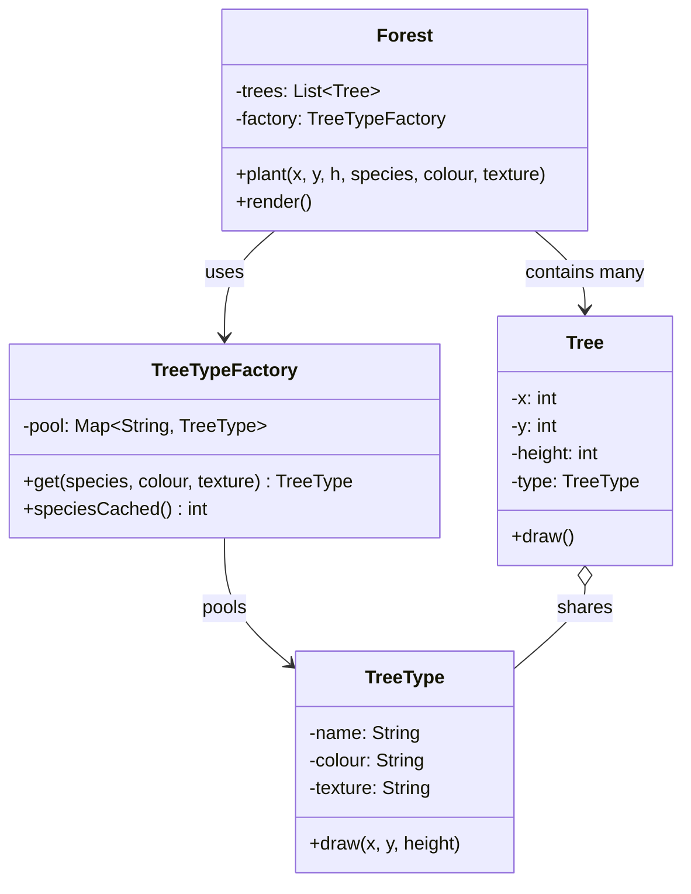
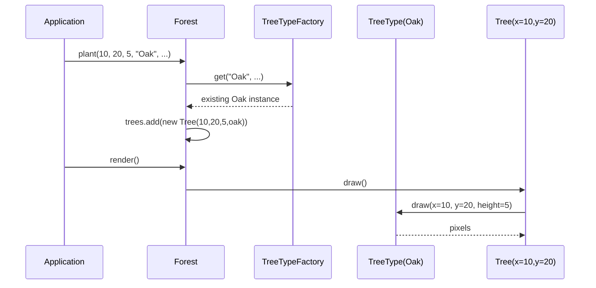

# Flyweight Design Pattern

## Youtube

- [30. Design Word Processor using Flyweight Design Pattern | Low Level System Design FlyWeight Pattern](https://www.youtube.com/watch?v=Mwm6tB3x1do)

## 1. Overview and Fundamentals

**Intent (GoF):** Use sharing to support large numbers of fine-grained objects efficiently.

**In one line:** Share what is common, pass what differs — hold a million objects for the price of a dozen.

**Real-world analogy:** Printed posters. The printing press holds one metal plate per character design (intrinsic, shared). Each impression's position on the page (extrinsic) is supplied at print time. You do not cast a new "A" plate for every "A" on the page.

**Family context:** Flyweight is a *structural* pattern. It restructures how object state is stored — splitting it into shared and per-use parts — rather than changing behaviour.

**Key participants:**

- `Flyweight` — shared object holding intrinsic (immutable, context-free) state (`TreeType`, `Glyph`).
- `ConcreteFlyweight` — specific shared variant (`OakType`, `Glyph('a', Arial-12-bold)`).
- `FlyweightFactory` — pool guaranteeing one instance per key (`computeIfAbsent`, `Map` cache).
- `Context` — tiny per-use object holding extrinsic state plus a flyweight pointer (`Tree` with x/y/height + `TreeType`).
- `Client` — passes extrinsic state into flyweight operations (`type.draw(x, y, height)`).

**Core characteristics:**

- **Intrinsic state:** Shareable, immutable, context-independent (character shape, tree texture, font metrics). Lives inside the flyweight.
- **Extrinsic state:** Varies per use, supplied by caller (position, size, selection). Lives outside, passed as parameters.
- Sharing is by identity: every "Oak" reference points to the *same* instance.
- Factory-keyed pooling (`Map<Key, Flyweight>`) enforces canonical instances.
- Pays off at scale (thousands to millions); overhead is unjustified for hundreds of objects.

**Mental model:**

```text
Forest: 1_000_000 Tree contexts (x, y, height + pointer)
        ---- share ----> 12 TreeType flyweights (mesh, texture, colour)
```

If the question is "how do we hold a million of these cheaply", use Flyweight. If it is "how do we ensure only one exists", use Singleton.

## 2. Detailed Theory

**Problem:** Naive modelling duplicates heavy data. A game with a million trees storing a 2 MB mesh each needs 2 TB. A text editor storing font, colour, and bitmap per character explodes similarly. Most per-object fields are actually identical across huge groups.

**Solution:** Split state. Move everything shareable into an immutable `Flyweight`. Keep only the varying fields plus a reference in a lightweight `Context`. Serve flyweights from a `Factory` pool keyed by intrinsic values so duplicates are impossible.

**Intrinsic vs extrinsic — the classification discipline:**

- Ask: "Can this field become a method parameter?" If yes, it is probably extrinsic (position, size, cursor).
- Ask: "Is this identical for all members of a group?" If yes, it is intrinsic (glyph bitmap, tree texture, icon pixels).
- A field that *looks* shared but varies (font size affecting line height, colour affecting hit-testing) must be extrinsic or part of the key — misclassification produces visual bugs or breaks sharing.
- Flyweights must be **immutable**: one stray setter corrupts every context sharing the instance. Make fields `final`/`readonly` and never expose mutators.

**Factory design:**

- Key by the full intrinsic tuple (`name|colour|texture`, `char|font|size`). A sloppy key merges distinct variants.
- Use `ConcurrentHashMap` + `computeIfAbsent` (Java), `functools.lru_cache`/dict with lock (Python), `sync.Map` (Go) for thread-safety.
- Pre-populate at startup when the variant set is known (ASCII glyphs, tile types); lazily create otherwise.
- Unlike a cache, entries are never evicted for age — sharing is the correctness mechanism, not a performance hint.

**Flyweight vs Cache vs Object Pool vs Singleton:**

- **Cache** memoises computation and evicts; flyweight pool defines identity and retains.
- **Object Pool** recycles mutable instances (connections, threads) to avoid construction cost; flyweights are immutable and never checked in/out.
- **Singleton** restricts to one global instance; flyweight maintains many canonical instances keyed by value.

**SOLID connections:**

- **Single Responsibility:** Factories own sharing; contexts own per-use state; flyweights own shared rendering.
- **Open/Closed:** New variants arrive as new keys, not new code paths.
- **Interface Segregation:** Flyweight interface exposes only operations parameterised by extrinsic state.

**Consequences:**

- Orders-of-magnitude memory savings at scale, at the cost of split-state complexity, extrinsic plumbing, and thread-safety care.
- CPU trade: cheaper allocation but extra parameter passing and pool lookups — profile both sides.

## 3. UML and Architecture Diagrams

### Diagram 1 — Class structure (pool, flyweight, context)



**Explanation:** `TreeType` (flyweight) holds only intrinsic data and is immutable. `TreeTypeFactory` guarantees canonical sharing — one instance per species key. `Tree` (context) is tiny: three ints plus a reference, no texture copy. `Forest` plants millions of contexts that all point at a handful of flyweights. The `o--` from `Tree` to `TreeType` shows sharing: thousands of contexts reference one flyweight.

### Diagram 2 — Shared rendering flow (sequence)



**Explanation:** Planting looks up (or creates once) the shared `Oak` flyweight, then stores only coordinates in the new context. Rendering passes extrinsic coordinates into the shared instance — the flyweight never stores position. A million `plant()` calls reuse the same `Oak` object; only contexts multiply.

## 4. Implementation Examples in Java, Python, and Go

### 4.1 Java (OOP, forest with shared tree types)

**Explanation:** `TreeType` is the immutable flyweight; `TreeTypeFactory` pools by key; `Tree` is the extrinsic context; `Forest` plants and renders. `main` plants 5 trees of 2 species and proves only 2 flyweights exist. Compile with `javac FlyweightDemo.java && java FlyweightDemo`.

```java
import java.util.ArrayList;
import java.util.HashMap;
import java.util.List;
import java.util.Map;

class TreeType {
    private final String name;
    private final String colour;
    private final String texture;

    TreeType(String name, String colour, String texture) {
        this.name = name;
        this.colour = colour;
        this.texture = texture;
    }

    void draw(int x, int y, int height) {
        System.out.println("Draw " + name + " at (" + x + "," + y
            + ") h=" + height + " [" + colour + "," + texture + "]");
    }
}

class TreeTypeFactory {
    private final Map<String, TreeType> pool = new HashMap<>();

    TreeType get(String name, String colour, String texture) {
        String key = name + "|" + colour;
        TreeType existing = pool.get(key);
        if (existing == null) {
            existing = new TreeType(name, colour, texture);
            pool.put(key, existing);
        }
        return existing;
    }

    int speciesCached() { return pool.size(); }
}

class Tree {
    private final int x, y, height;
    private final TreeType type;

    Tree(int x, int y, int height, TreeType type) {
        this.x = x; this.y = y; this.height = height; this.type = type;
    }

    void draw() { type.draw(x, y, height); }
}

class Forest {
    private final List<Tree> trees = new ArrayList<>();
    private final TreeTypeFactory factory = new TreeTypeFactory();

    void plant(int x, int y, int height, String species,
               String colour, String texture) {
        trees.add(new Tree(x, y, height, factory.get(species, colour, texture)));
    }

    void render() {
        for (Tree t : trees) t.draw();
        System.out.println("Trees=" + trees.size()
            + " species=" + factory.speciesCached());
    }
}

public class FlyweightDemo {
    public static void main(String[] args) {
        Forest forest = new Forest();
        forest.plant(10, 20, 5, "Oak", "green", "oak.png");
        forest.plant(30, 40, 6, "Oak", "green", "oak.png");
        forest.plant(50, 60, 7, "Oak", "green", "oak.png");
        forest.plant(70, 80, 4, "Pine", "darkgreen", "pine.png");
        forest.plant(90, 15, 5, "Pine", "darkgreen", "pine.png");
        forest.render();
    }
}
```

**Sample I/O:**

```text
Draw Oak at (10,20) h=5 [green,oak.png]
Draw Oak at (30,40) h=6 [green,oak.png]
Draw Oak at (50,60) h=7 [green,oak.png]
Draw Pine at (70,80) h=4 [darkgreen,pine.png]
Draw Pine at (90,15) h=5 [darkgreen,pine.png]
Trees=5 species=2
```

### 4.2 Python (pythonic, PEP 8, glyph pool)

**Explanation:** Character glyphs share bitmap data; positions are extrinsic. `GlyphFactory` interns by `(char, font)` key. `TextChar` is the context. The demo renders "hello" proving repeated letters share instances via `is`. Run with `python flyweight_demo.py`.

```python
"""Flyweight pattern: share glyph bitmaps, pass positions per use."""


class Glyph:
    """Flyweight: immutable shared bitmap for one (char, font)."""

    __slots__ = ("char", "font", "bitmap")

    def __init__(self, char: str, font: str) -> None:
        self.char = char
        self.font = font
        self.bitmap = f"[{font}:{char}]"  # stand-in for heavy raster data

    def draw(self, x: int, y: int) -> None:
        print(f"Draw {self.bitmap} at ({x},{y})")


class GlyphFactory:
    """Pool: one canonical Glyph per key."""

    def __init__(self) -> None:
        self._pool: dict[tuple[str, str], Glyph] = {}

    def get(self, char: str, font: str = "Arial-12") -> Glyph:
        key = (char, font)
        glyph = self._pool.get(key)
        if glyph is None:
            glyph = Glyph(char, font)
            self._pool[key] = glyph
        return glyph

    def cached(self) -> int:
        return len(self._pool)


class TextChar:
    """Context: extrinsic position plus shared glyph pointer."""

    def __init__(self, x: int, y: int, glyph: Glyph) -> None:
        self.x = x
        self.y = y
        self.glyph = glyph

    def draw(self) -> None:
        self.glyph.draw(self.x, self.y)


if __name__ == "__main__":
    factory = GlyphFactory()
    word = [TextChar(i * 10, 0, factory.get(ch)) for i, ch in enumerate("hello")]
    for ch in word:
        ch.draw()
    print(f"Chars={len(word)} glyphs={factory.cached()}")
    print(f"Shared l: {word[2].glyph is word[3].glyph}")
```

**Sample I/O:**

```text
Draw [Arial-12:h] at (0,0)
Draw [Arial-12:e] at (10,0)
Draw [Arial-12:l] at (20,0)
Draw [Arial-12:l] at (30,0)
Draw [Arial-12:o] at (40,0)
Chars=5 glyphs=4
Shared l: True
```

### 4.3 Go (idiomatic, particle pool)

**Explanation:** Bullets share sprite/texture; each bullet carries only coordinates and velocity. `ParticleFactory` pools by kind. The demo spawns 4 bullets of 2 kinds and renders them. Run with `go run flyweight_demo.go`.

```go
package main

import "fmt"

// Flyweight: shared intrinsic sprite data.
type ParticleType struct {
	kind    string
	sprite  string
	damage  int
}

func (p *ParticleType) Draw(x, y int) {
	fmt.Printf("Draw %s at (%d,%d) [%s dmg=%d]\n", p.kind, x, y, p.sprite, p.damage)
}

// Factory: canonical instance per kind.
type ParticleFactory struct {
	pool map[string]*ParticleType
}

func NewParticleFactory() *ParticleFactory {
	return &ParticleFactory{pool: make(map[string]*ParticleType)}
}

func (f *ParticleFactory) Get(kind, sprite string, damage int) *ParticleType {
	if p, ok := f.pool[kind]; ok {
		return p
	}
	p := &ParticleType{kind: kind, sprite: sprite, damage: damage}
	f.pool[kind] = p
	return p
}

func (f *ParticleFactory) Cached() int { return len(f.pool) }

// Context: extrinsic position plus shared type.
type Bullet struct {
	x, y int
	kind *ParticleType
}

func (b *Bullet) Draw() { b.kind.Draw(b.x, b.y) }

func main() {
	factory := NewParticleFactory()
	bullets := []*Bullet{
		{x: 1, y: 2, kind: factory.Get("plasma", "plasma.png", 10)},
		{x: 3, y: 4, kind: factory.Get("plasma", "plasma.png", 10)},
		{x: 5, y: 6, kind: factory.Get("shell", "shell.png", 25)},
		{x: 7, y: 8, kind: factory.Get("shell", "shell.png", 25)},
	}
	for _, b := range bullets {
		b.Draw()
	}
	fmt.Printf("Bullets=%d types=%d\n", len(bullets), factory.Cached())
	fmt.Println("Shared plasma:", bullets[0].kind == bullets[1].kind)
}
```

**Sample I/O:**

```text
Draw plasma at (1,2) [plasma.png dmg=10]
Draw plasma at (3,4) [plasma.png dmg=10]
Draw shell at (5,6) [shell.png dmg=25]
Draw shell at (7,8) [shell.png dmg=25]
Bullets=4 types=2
Shared plasma: true
```

## 5. Real-World Industry Applications

- **Text editors and browsers (Word, Chrome, Skia):** Glyph caches share rasterised characters across every occurrence; layout passes positions per frame.
- **Game engines (Unity, Unreal):** Particle systems, bullets, and instanced meshes share textures/materials across thousands of entities.
- **JVM string interning / Python `sys.intern`:** Identical string literals share one heap object automatically.
- **Map renderers (Google Maps, Mapbox):** Tile images shared across views, zooms, and sessions; viewport coordinates are extrinsic.
- **UI icon/theme caches:** One pixmap per icon shared by every button, menu, and toolbar instance.
- **Regex / font engines:** Compiled patterns and font faces cached once, executed with per-call input.

## 6. Practical Use Cases and Scenarios

1. **Word processor:** Million-character document shares ~100 glyph flyweights; caret positions and selections stay extrinsic.
2. **Game forest/battlefield:** Million trees or particles share a dozen meshes; coordinates and HP are per-context.
3. **Spreadsheet grid:** Cells share style flyweights (font, border, format); values and coordinates stay per-cell.
4. **Chat emoji rendering:** Each emoji shortcode maps to one shared bitmap; message positions are extrinsic.
5. **Network packet visualisation:** Packet kinds share colour/shape; timestamps and routes are per-packet context.
6. **Report charts:** Data points share marker/colour styles; x/y values passed per draw call.

## 7. When to Use and When Not to Use

**Use Flyweight when ALL of these hold:**

- Application uses very large numbers of similar objects (thousands+).
- Memory cost is high and measurable via profiling.
- Most state can be made extrinsic and passed per call.
- Object identity is irrelevant — shared instances are interchangeable.
- Flyweights can be immutable (or safely read-only through sharing).

**Do NOT use Flyweight when:**

- Object counts are modest — the pool and split add complexity for no gain.
- State cannot be cleanly split — smuggling extrinsic fields inside breaks sharing or correctness.
- Identity matters (each object needs its own lifecycle, listeners, or mutable history) — sharing corrupts peers.
- A simple cache or pool solves the actual problem (recomputation cost vs memory footprint confusion).
- Single shared coordinator is the goal — that is Singleton, not Flyweight.

## 8. Do's and Don'ts

**Do:**

- Make flyweights immutable: `final` fields, no setters, defensive copies on construction.
- Key the factory on the complete intrinsic tuple; document what the key includes.
- Pass extrinsic state as parameters to every flyweight operation — never store it inside.
- Use concurrent maps (`ConcurrentHashMap`, `sync.Map`) or pre-populate for thread-safety.
- Prove value with heap measurements before and after; assert sharing with identity checks in tests.

**Don't:**

- Don't store positions, selections, or per-use flags inside the flyweight.
- Don't use weak/soft keys that let canonical instances vanish mid-render.
- Don't merge distinct variants with sloppy keys (ignoring font size or colour when it matters).
- Don't expose the pool's live map — return flyweights, not pool internals.
- Don't apply flyweight to a few hundred small objects — YAGNI.

| Do | Don't |
|----|-------|
| Immutable `TreeType` with `final` fields | Setter mutating shared texture at runtime |
| `pool.computeIfAbsent(key, ...)` atomically | Check-then-act race creating duplicates |
| Pass `(x, y, height)` per `draw()` | Store cursor position inside `Glyph` |
| Profile heap with/without sharing | Assume sharing helps without measuring |

## 9. Comparison with Other Design Patterns

| Aspect | Flyweight | Object Pool | Cache | Singleton |
|--------|-----------|-------------|-------|-----------|
| **Goal** | Minimise memory via intrinsic sharing | Reuse expensive mutable objects | Avoid recomputation via memoisation | Ensure exactly one instance |
| **Mutability** | Immutable shared state | Mutable, checked in/out | Values may expire/invalidate | Single mutable global |
| **Lookup** | Pool keyed by intrinsic value, retained forever | Acquire/release lifecycle | Keyed by input, evicted by policy | Global accessor |
| **State split** | Strict intrinsic vs extrinsic | None — whole object recycled | None — whole result stored | None — one state |
| **Eviction** | Never (sharing is correctness) | Bounded pool with blocking/creation | TTL/LRU eviction routine | N/A |
| **Example** | `TreeType` per species, glyph per char | DB connection pool, thread pool | HTTP response cache, memoised fib | Config holder, logger |
| **Without it** | Memory explosion at scale | Construction churn / exhaustion | Repeated expensive compute | Multiple coordinators diverge |

**Flyweight vs Prototype:** Prototype clones a template per use (each clone independent); Flyweight shares one template across uses (contexts carry differences). Clone when independence matters; share when identity does not.

**When to pick which:** Millions of similar objects → Flyweight. Expensive reusable resources → Pool. Repeated computation → Cache. One coordinator → Singleton.

## 10. Interview Preparation

**Q1: What is intrinsic vs extrinsic state?**
Intrinsic is shareable and context-free (glyph bitmap, tree texture) and lives inside the flyweight. Extrinsic varies per use (position, size) and is stored by the caller and passed into each operation. Misclassification breaks either memory savings (extrinsic smuggled inside forces one instance per use) or correctness (shared mutable position corrupts peers).

**Q2: How does Flyweight differ from Cache, Pool, and Singleton?**
Cache memoises computation with eviction to save time; pool recycles mutable resources to save construction cost; Singleton enforces one instance for coordination; Flyweight shares immutable internals across many instances to save memory. Different resource, different lifecycle, different eviction story.

**Q3: Why must flyweights be immutable?**
Because every context shares the same instance — one mutation is visible to all million users of that flyweight. Immutability (`final` fields, no setters) makes sharing safe. All variation belongs in extrinsic context objects.

**Q4: What are the concurrency pitfalls?**
Check-then-act pool insertion races create duplicates — use `computeIfAbsent` / `sync.Map` / locks. Shared mutable fields cause data races across contexts. Key design must be complete: two threads inserting the same logical variant under different keys silently breaks sharing.

**Q5: How do you prove Flyweight is worth it?**
Measure heap with and without sharing over realistic counts. Assert sharing directly (`factory.get('a') == factory.get('a')`, pool size after duplicates). Load-test render/draw loops for CPU cost of extrinsic passing. Confirm mutating one context never affects siblings.

**Q6: Where do extrinsic operations live?**
Either the client passes extrinsic values into flyweight methods (`type.draw(x, y)`), or a context object holds extrinsic fields and forwards them. Never store extrinsic fields on the flyweight itself.

**Q7: Give JDK/framework examples.**
`String.intern()`, `Integer.valueOf()` caching -128..127, `Font`/`Color` factories in UI toolkits, glyph caches in text renderers, and tile caches in map SDKs. `Boolean.valueOf()` is a degenerate two-instance flyweight.

**Q8: What breaks if the key is wrong?**
Over-broad keys merge distinct variants (12pt and 24pt glyphs sharing bitmaps → rendering bugs). Over-narrow keys split identical variants (including object hash in key → no sharing at all). Key must equal the full intrinsic tuple, nothing more, nothing less.

**LLD Scenario 1 — Word processor:** Design glyph sharing for a million-character doc with fonts, sizes, colours. Discuss what is intrinsic (bitmap per char+font+size) vs extrinsic (position, selection), factory key, and memory math. Expected: flyweight, context, factory, identity tests, heap proof.

**LLD Scenario 2 — Top-down shooter particles:** 100k bullets of 8 kinds with position, velocity, TTL. Design `ParticleType` pool plus `Bullet` contexts updated per tick. Discuss thread-safety of the pool and where collision state lives. Expected: immutable types, extrinsic motion, concurrent factory, tick-loop rendering.

**LLD Scenario 3 — Spreadsheet cell styles:** Million cells sharing ~50 style combos (font, border, format). Design style flyweight keyed by full style tuple, cell contexts with values. Discuss adding a new style at runtime and serialisation. Expected: style pool, cell context, key design, style-dedup on paste.

## 11. Testing and Best Practices

**Unit tests:**

- Assert canonical sharing: `factory.get(k) == factory.get(k)` (reference equality) and pool size stays flat after duplicates.
- Assert extrinsic isolation: move one context, verify siblings unchanged.
- Assert immutability: no setters exist; attempt reflective mutation in a dedicated test if paranoid.
- Assert key correctness: variants differing in any intrinsic field produce distinct instances.

**Load and memory tests:**

- Heap-dump with and without sharing at realistic scale; require documented savings before keeping the pattern.
- Render/draw loop benchmarks proving extrinsic-passing CPU cost is acceptable.
- Concurrency test: parallel `get()` calls never create duplicates and never throw.

**Best practices:**

- Pre-populate known variants at startup (ASCII set, base tiles) to avoid first-use latency.
- Keep extrinsic structs tiny and cache-friendly (plain fields, no boxing in hot loops).
- Combine with Composite (shared leaves in trees) and Prototype (clone-then-share workflows) where natural.
- Document the intrinsic/extrinsic split in code comments — future maintainers will otherwise "fix" it back together.

| Aspect | Impact |
|--------|--------|
| **Memory** | Sharply reduced at scale (12 shared vs 1M copies) |
| **Runtime cost** | Medium (pool lookup once; extrinsic passing per call) |
| **Scalability** | Very high (flat memory as count grows) |
| **Risk** | Misclassification and shared mutation — immutability + key discipline |

## 12. Summary and Key Takeaways

- **Flyweight = share the common, pass the rest:** Intrinsic immutable state pooled; extrinsic state supplied per call.
- **Factory guarantees canonical instances** keyed by the full intrinsic tuple — sloppy keys break sharing or correctness.
- **Immutability is non-negotiable** for shared instances; all mutation belongs in contexts.
- **Measure before adopting:** Worth it for thousands+ of heavy similar objects; overhead otherwise.
- **Distinguish neighbours:** Memory sharing → Flyweight; time saving → Cache; resource recycling → Pool; one coordinator → Singleton; cloned templates → Prototype.
- **Test identity, isolation, and heap:** Reference equality, sibling independence, and measured memory wins.
