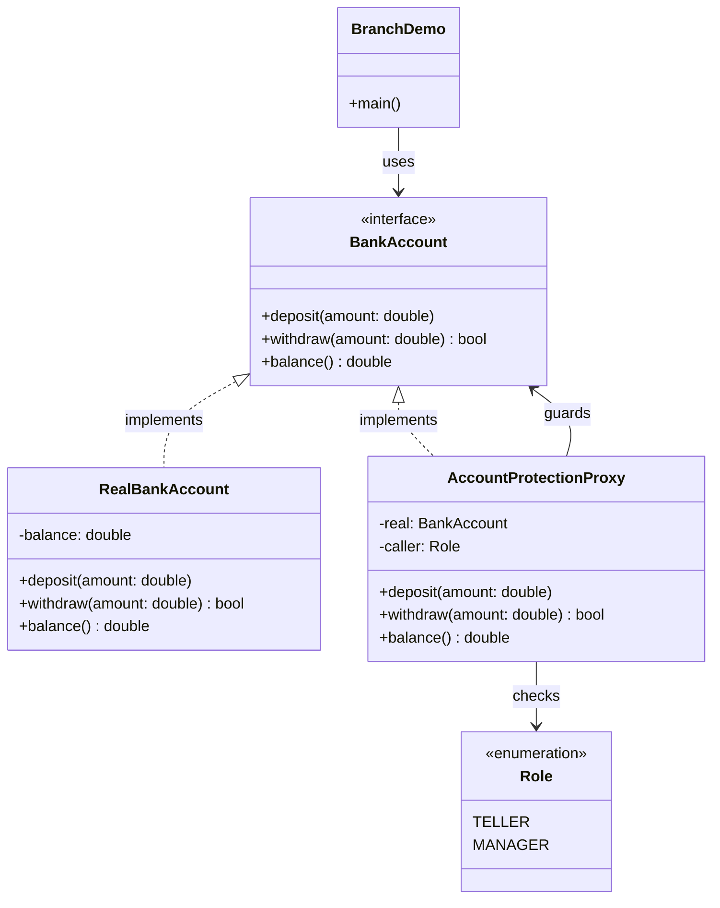
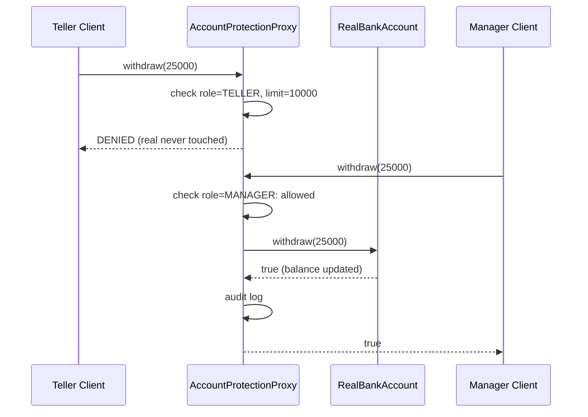

# Proxy Design Pattern

## Youtube

- [13. Proxy Design Pattern Explanation (Hindi) | LLD | System Design Interview Question | Java](https://www.youtube.com/watch?v=9MxHKlVc6ZM)

## 1. Overview and Fundamentals

**Intent (GoF):** Provide a surrogate or placeholder for another object to control access to it.

**In one line:** A stand-in with the same face — clients talk to the proxy thinking it is the real thing, while it guards, defers, or enhances access.

**Real-world analogy:** A bank locker assistant. You cannot walk into the vault yourself. The assistant (proxy) checks your identity, fetches the locker, logs access, and hands you the contents. You use the same request slip either way.

**Family context:** Proxy is a *structural* pattern. It structures access to a single object, unlike Facade (many objects) or Composite (tree of objects).

**Key participants:**

- `Subject` — common interface for real and proxy (`BankAccount`, `Image`).
- `RealSubject` — the actual object doing the work (`RealBankAccount`, `HighResImage`).
- `Proxy` — implements `Subject`, holds a reference to `RealSubject`, adds control logic.
- `Client` — depends only on `Subject`, unaware whether it holds proxy or real object.

**Four classic proxy types:**

- **Virtual Proxy:** Defers expensive creation until first use (lazy image loading, Hibernate entities).
- **Protection Proxy:** Checks permissions before delegating (teller limits, Spring Security).
- **Remote Proxy:** Local stub for a remote object (gRPC stub, REST client, RMI).
- **Smart / Cache Proxy:** Adds bookkeeping — caching, reference counting, logging, metrics — around calls.

**Core characteristics:**

- Same interface as the real object — substitutable anywhere.
- Client ideally does not know the proxy exists; construction is hidden by factory/DI.
- Typically one proxy per concern; stacking is possible but ordering must be documented.
- May manage the real object's lifecycle: create lazily, pool, refresh, or evict.
- Adds one indirection hop — negligible for I/O, measurable for hot loops.

**Mental model:**

```text
Client -> BankAccount.withdraw()
           |
     AccountProtectionProxy (checks role, audits)
           |
     RealBankAccount (pure ledger math)
```

If the wrapper says "you may not" or "not yet", it is a Proxy. If it says "and also", it is a Decorator.

## 2. Detailed Theory

**Problem:** Direct access to the real object is wrong: creation is too expensive to do eagerly, callers lack permission checks, the object lives on another machine, or every call needs caching/logging. Scattering `if (allowed)` or `if (cached)` checks across callers duplicates policy and leaks concerns.

**Solution:** Introduce a proxy implementing the same interface. Route all client calls through it. The proxy enforces its one concern (auth, laziness, caching, remoteness) and delegates to the real subject only when appropriate.

**How each proxy type works:**

- **Virtual proxy:** Holds a nullable reference; creates `RealSubject` on first method call (double-checked locking for threads). Later calls reuse it. Ideal for heavy images, large reports, or expensive model loads.
- **Protection proxy:** Holds caller identity (role, token, ACL). Each method checks permission before delegating; denied calls never touch the real object and are audited. Keeps security out of domain logic.
- **Remote proxy:** Encodes calls (marshalling, HTTP/gRPC), sends over the wire, decodes responses, translates transport errors. Client sees a local interface; network lives inside the proxy.
- **Cache proxy:** Stores results keyed by arguments with TTL/invalidation. Read path checks cache first; write path updates or invalidates. Must define coherence rules (write-through vs write-behind).
- **Smart/logging proxy:** Records metrics, traces, reference counts, or copy-on-write behaviour transparently.

**Static vs dynamic proxies (Java):**

- **Static proxy:** Hand-written class per interface. Simple, explicit, domain-aware. Best for protection policies with business rules.
- **Dynamic proxy (`java.lang.reflect.Proxy`):** One `InvocationHandler` generates wrappers for any interface at runtime. Best for cross-cutting concerns (logging, transactions, metrics).
- **Bytecode proxies (CGLib, ByteBuddy):** Proxy concrete classes without interfaces by subclassing at runtime. Powers Spring AOP for class-based beans.
- Python equivalents: `__getattr__` delegation, `functools.wraps` decorators, library proxies. Go equivalents: struct wrapping the interface, `http.RoundTripper` chains.

**Proxy vs Decorator vs Adapter vs Facade:**

- **Proxy** controls access to one object, same interface, ideally invisible.
- **Decorator** adds features to one object, same interface, explicitly stacked by client.
- **Adapter** changes the interface to fix mismatch.
- **Facade** simplifies many objects behind one entry point.

**SOLID connections:**

- **Single Responsibility:** Each proxy owns one access concern; domain stays pure.
- **Open/Closed:** New policy (rate limiting) arrives as a new proxy, not by editing the real subject.
- **Liskov Substitution:** Proxy substitutes for real subject in every test and call site.
- **Dependency Inversion:** Clients depend on `Subject` abstraction, never on proxy or real concretes.

**Consequences:**

- Clean separation of access policy from domain logic, at the cost of indirection, longer stack traces, and potential surprise (cached denial, unaudited cache hit) when proxies stack.

## 3. UML and Architecture Diagrams

### Diagram 1 — Class structure (protection proxy)



**Explanation:** Both `RealBankAccount` and `AccountProtectionProxy` implement `BankAccount`, so `BranchDemo` cannot tell them apart. The proxy holds a reference to the real account plus the caller's role. Withdrawals from tellers above the limit are denied before the real object is touched; manager calls delegate with audit logging. Security lives in one class; ledger math stays pure.

### Diagram 2 — Guarded call flow (sequence)



**Explanation:** The sequence shows the proxy's gatekeeping. The teller's oversized withdrawal is rejected inside the proxy — no ledger call, no state change. The manager's identical call passes the check, delegates, and gets audited. Both callers use the same `withdraw()` signature; policy is invisible in the interface but explicit in the trace.

## 4. Implementation Examples in Java, Python, and Go

### 4.1 Java (OOP, protection proxy with audit)

**Explanation:** `RealBankAccount` holds only balance logic. `AccountProtectionProxy` enforces teller limits and audits every call. `BranchDemo` wires the same real account behind two proxies (teller vs manager) proving identical interface, different power. Compile with `javac ProxyDemo.java && java BranchDemo`.

```java
interface BankAccount {
    void deposit(double amount);
    boolean withdraw(double amount);
    double balance();
}

class RealBankAccount implements BankAccount {
    private double balance;
    RealBankAccount(double opening) { this.balance = opening; }
    @Override public void deposit(double amount) { balance += amount; }
    @Override public boolean withdraw(double amount) {
        if (amount > balance) return false;
        balance -= amount;
        return true;
    }
    @Override public double balance() { return balance; }
}

enum Role { TELLER, MANAGER }

class AccountProtectionProxy implements BankAccount {
    private final BankAccount real;
    private final Role caller;
    private static final double TELLER_LIMIT = 10_000;

    AccountProtectionProxy(BankAccount real, Role caller) {
        this.real = real;
        this.caller = caller;
    }

    @Override
    public void deposit(double amount) {
        real.deposit(amount);
        System.out.println("AUDIT deposit $" + amount + " by " + caller);
    }

    @Override
    public boolean withdraw(double amount) {
        if (caller == Role.TELLER && amount > TELLER_LIMIT) {
            System.out.println("DENIED: teller limit is $" + TELLER_LIMIT);
            return false;
        }
        boolean ok = real.withdraw(amount);
        System.out.println("AUDIT withdraw $" + amount + " by " + caller + " ok=" + ok);
        return ok;
    }

    @Override
    public double balance() { return real.balance(); }
}

class BranchDemo {
    public static void main(String[] args) {
        BankAccount account = new RealBankAccount(50_000);
        BankAccount teller = new AccountProtectionProxy(account, Role.TELLER);
        BankAccount manager = new AccountProtectionProxy(account, Role.MANAGER);
        teller.withdraw(25_000);
        manager.withdraw(25_000);
        System.out.println("Final balance: $" + account.balance());
    }
}
```

**Sample I/O:**

```text
DENIED: teller limit is $10000.0
AUDIT withdraw $25000.0 by MANAGER ok=true
Final balance: $25000.0
```

### 4.2 Python (pythonic, PEP 8, virtual + protection proxy)

**Explanation:** `RealImage` simulates expensive loading. `ImageProxy` defers loading until first `display()` (virtual proxy). `AccountProxy` enforces role limits (protection proxy). Both honour their subject protocols so clients are unchanged. Run with `python proxy_demo.py`.

```python
"""Proxy pattern: virtual image loader and protection proxy for accounts."""
from abc import ABC, abstractmethod
from enum import Enum


class Image(ABC):
    """Subject for virtual proxy."""

    @abstractmethod
    def display(self) -> None:
        ...


class RealImage(Image):
    """Expensive real subject: loading happens in constructor."""

    def __init__(self, filename: str) -> None:
        self._filename = filename
        print(f"Loading heavy image {filename} from disk...")

    def display(self) -> None:
        print(f"Display {self._filename}")


class ImageProxy(Image):
    """Virtual proxy: lazy-loads RealImage on first use."""

    def __init__(self, filename: str) -> None:
        self._filename = filename
        self._real: RealImage | None = None

    def display(self) -> None:
        if self._real is None:
            self._real = RealImage(self._filename)
        self._real.display()


class Role(Enum):
    TELLER = "TELLER"
    MANAGER = "MANAGER"


class BankAccount(ABC):
    """Subject for protection proxy."""

    @abstractmethod
    def withdraw(self, amount: float) -> bool:
        ...


class RealBankAccount(BankAccount):
    def __init__(self, balance: float) -> None:
        self._balance = balance

    def withdraw(self, amount: float) -> bool:
        if amount > self._balance:
            return False
        self._balance -= amount
        return True

    @property
    def balance(self) -> float:
        return self._balance


class AccountProxy(BankAccount):
    """Protection proxy: enforces teller limits and audits."""

    TELLER_LIMIT = 10_000.0

    def __init__(self, real: BankAccount, caller: Role) -> None:
        self._real = real
        self._caller = caller

    def withdraw(self, amount: float) -> bool:
        if self._caller == Role.TELLER and amount > self.TELLER_LIMIT:
            print(f"DENIED: teller limit is ${self.TELLER_LIMIT:,.0f}")
            return False
        ok = self._real.withdraw(amount)
        print(f"AUDIT withdraw ${amount:,.0f} by {self._caller.value} ok={ok}")
        return ok


if __name__ == "__main__":
    print("--- virtual proxy ---")
    img: Image = ImageProxy("photo.jpg")
    print("proxy created, nothing loaded yet")
    img.display()
    img.display()  # second call reuses loaded image

    print("--- protection proxy ---")
    real = RealBankAccount(50_000)
    AccountProxy(real, Role.TELLER).withdraw(25_000)
    AccountProxy(real, Role.MANAGER).withdraw(25_000)
    print(f"Final balance: ${real.balance:,.0f}")
```

**Sample I/O:**

```text
--- virtual proxy ---
proxy created, nothing loaded yet
Loading heavy image photo.jpg from disk...
Display photo.jpg
Display photo.jpg
--- protection proxy ---
DENIED: teller limit is $10,000
AUDIT withdraw $25,000 by MANAGER ok=True
Final balance: $25,000
```

### 4.3 Go (idiomatic, cache proxy)

**Explanation:** `RealWeatherService` simulates a slow upstream call. `WeatherCacheProxy` implements the same `WeatherService` interface, caching results by city. The first call for a city is slow; repeats are instant. Run with `go run proxy_demo.go`.

```go
package main

import (
	"fmt"
	"time"
)

// Subject.
type WeatherService interface {
	Temperature(city string) string
}

// RealSubject: slow upstream (simulated with sleep).
type RealWeatherService struct{}

func (r *RealWeatherService) Temperature(city string) string {
	time.Sleep(200 * time.Millisecond) // simulate network
	return "22C in " + city
}

// Cache/smart proxy: memoises per city.
type WeatherCacheProxy struct {
	real  WeatherService
	cache map[string]string
}

func NewWeatherCacheProxy() *WeatherCacheProxy {
	return &WeatherCacheProxy{real: &RealWeatherService{}, cache: make(map[string]string)}
}

func (p *WeatherCacheProxy) Temperature(city string) string {
	if v, ok := p.cache[city]; ok {
		fmt.Println("CACHE hit for " + city)
		return v
	}
	fmt.Println("CACHE miss for " + city)
	v := p.real.Temperature(city)
	p.cache[city] = v
	return v
}

func main() {
	var svc WeatherService = NewWeatherCacheProxy()
	start := time.Now()
	fmt.Println(svc.Temperature("Pune"))
	fmt.Println(svc.Temperature("Pune"))
	fmt.Println("elapsed:", time.Since(start).Round(time.Millisecond))
}
```

**Sample I/O:**

```text
CACHE miss for Pune
22C in Pune
CACHE hit for Pune
22C in Pune
elapsed: 200ms
```

## 5. Real-World Industry Applications

- **Lazy media loading (virtual):** Thumbnail grids load full images on demand; Hibernate/JPA lazy-loads entity graphs; `java.util.Optional`-style holders defer heavy reports.
- **Access control (protection):** Spring Security method proxies, database view restrictions, S3 IAM policies enforced in SDK proxies.
- **Remote services (remote):** gRPC stubs, Retrofit/Feign HTTP clients, RMI skeletons — local interfaces hiding network marshaling.
- **CDN and edge caching (cache):** Cloudflare/Akamai proxies cache origin content; in-app memoising proxies cut repeated pricing or config fetches.
- **API gateways and reverse proxies:** Nginx/HAProxy/Envoy front backends with TLS, rate limiting, and routing — infrastructure-scale proxies.
- **Observability (smart/logging):** Spring AOP, Micrometer, and OpenTelemetry wrappers add latency histograms and traces around service calls without touching business code.

## 6. Practical Use Cases and Scenarios

1. **Image gallery:** Virtual proxy shows thumbnails instantly; full resolution loads on click — startup stays fast.
2. **Branch banking:** Protection proxy enforces teller/manager limits and audits, keeping ledger code policy-free.
3. **Microservice client:** Remote proxy hides HTTP/gRPC details, retries, and error mapping behind a domain interface.
4. **Weather/pricing feed:** Cache proxy memoises slow upstream calls per key with TTL, surviving traffic spikes.
5. **Rate-limited API:** Smart proxy throttles and queues calls, returning 429-friendly fallbacks instead of hammering the provider.
6. **Audit trail:** Logging proxy records who called what with arguments and duration for compliance, zero business-code changes.

## 7. When to Use and When Not to Use

**Use Proxy when:**

- Object creation is expensive and often unused — defer with virtual proxy.
- Access needs permission checks, quotas, or auditing — guard with protection proxy.
- The real object is remote — hide transport with remote proxy.
- Calls are repeated and cacheable — memoise with cache proxy.
- Cross-cutting telemetry is needed without polluting domain code.

**Do NOT use Proxy when:**

- The goal is adding stackable product features — that is Decorator.
- The goal is simplifying many objects — that is Facade.
- The interface itself mismatches — that is Adapter.
- Every call is unique and cheap — caching/protection overhead buys nothing.
- A single proxy accumulates auth plus cache plus logging plus retry — split into focused layers with documented order.

## 8. Do's and Don'ts

**Do:**

- Keep one concern per proxy; compose (`Cache(Auth(Real))`) with explicit ordering.
- Implement the full subject interface — every method must delegate, guard, or cache faithfully.
- Make laziness thread-safe (double-checked locking, `sync.Once`, locks) when shared.
- Audit denials and cache bypasses so behaviour is observable in production.
- Hide proxy construction behind factories or DI so clients stay interface-coupled.

**Don't:**

- Don't let new interface methods silently bypass the guard — update proxies with the subject.
- Don't return stale cache entries without TTL/invalidation — define coherence up front.
- Don't stack proxies so deep that latency and stack traces become undebuggable.
- Don't put business rules inside proxies — policy (who may) yes, pricing/workflows no.
- Don't use proxies to hide failures — translate and propagate with context.

| Do | Don't |
|----|-------|
| One focused proxy per concern | God proxy doing auth + cache + retry + metrics |
| Thread-safe lazy init | Racy `if real == null` without locking |
| Cache with TTL + invalidation | Unbounded cache that serves forever-stale data |
| Factory hides `new Proxy(real)` | Sprinkle `new Proxy` across callers |

## 9. Comparison with Other Design Patterns

| Aspect | Proxy | Decorator | Adapter |
|--------|-------|-----------|---------|
| **Intent** | Control access (guard, defer, cache) | Add responsibilities openly | Convert incompatible interface |
| **Transparency** | Ideally invisible to client | Explicitly composed by client | Hidden behind target interface |
| **Interface** | Same as subject; one layer typical | Same as component; many layers normal | Changes to target |
| **Lifecycle role** | May create, cache, refresh real object | Never manages lifecycle | Stateless translator |
| **Who decides** | Framework/factory injects proxy | Caller nests decorators | Adapter fixed at wiring |
| **Example** | `AccountProtectionProxy`, lazy `ImageProxy` | `EncryptionDecorator`, `BufferedInputStream` | `StripeAdapter` |
| **Without it** | Scattered guards / eager cost / leaky remote | 2^N subclasses | Code does not compile |

**Proxy vs Facade:** Proxy fronts *one* object with the *same* interface to control access; Facade fronts *many* objects with a *simpler* interface to reduce effort. Proxy says "not yet / you may not"; Facade says "let me do those five steps for you".

**Proxy vs Cache (pattern-adjacent):** A cache proxy *is* a proxy whose policy is memoisation. Standalone caches optimise time with eviction; proxy framing adds substitutability — the client cannot tell caching happens.

**When to pick which:** Guard/defer/cache one object → Proxy. Stack opt-in features → Decorator. Fix signatures → Adapter. Simplify subsystem → Facade.

## 10. Interview Preparation

**Q1: What is Proxy and what are its four classic types?**
A surrogate with the same interface controlling access to the real object. Virtual defers expensive creation; protection enforces permissions; remote stands in for a distant object; smart/cache adds bookkeeping like caching or logging around calls.

**Q2: Proxy vs Decorator — both wrap with the same interface, so what differs?**
Proxy guards or optimises transparently (`you may not / not yet`), usually single-layer and framework-injected, and may manage lifecycle. Decorator adds features openly (`and also`), stacked many-deep by the caller, never managing lifecycle. Teller-limit guard is Proxy; encryption topping is Decorator.

**Q3: How do static and dynamic proxies differ in Java?**
Static proxies are hand-written classes per interface — simple and domain-expressive. Dynamic proxies (`java.lang.reflect.Proxy`) generate wrappers from one `InvocationHandler` for any interface — ideal for generic logging/transactions. Spring AOP builds on dynamic proxies plus CGLib/ByteBuddy for class-based beans.

**Q4: How do you implement a thread-safe virtual proxy?**
Guard lazy creation with double-checked locking (Java `volatile` + `synchronized`), `sync.Once` in Go, or a lock in Python. Ensure exactly-once creation under concurrency and publish safely so all threads see the initialised object.

**Q5: What are the pitfalls of stacking proxies?**
Each layer adds latency and stack depth. Interactions surprise: cached denials, unaudited cache hits, retries amplifying non-idempotent calls. Mitigate with one concern per proxy, documented ordering, and measurements on hot paths.

**Q6: How do cache proxies stay correct?**
Key on full request identity, set TTLs, invalidate on writes, and bound size. Distinguish cacheable (idempotent reads) from non-cacheable (withdrawals, mutations) — never cache the latter without explicit versioning.

**Q7: Give framework examples of each proxy type.**
Virtual: Hibernate lazy entities, image lazy-loaders. Protection: Spring Security `@PreAuthorize` proxies. Remote: gRPC stubs, Feign clients. Cache/smart: CDN edge caches, Spring `@Cacheable` proxies, ORM second-level cache.

**Q8: What is the performance story?**
One delegation hop is negligible next to I/O; virtual proxies *save* time by skipping unused work; cache proxies trade memory for latency. Risk is on nanosecond hot loops and deep stacks — profile, keep proxies shallow there, and never proxy what you can inline after measurement.

**LLD Scenario 1 — Role-based document vault:** Design `DocumentStore` with `read/write` plus `AccessProxy` enforcing owner/editor/viewer rights with audit logs. Discuss where ACLs are stored, denial responses, and test matrix. Expected: subject interface, proxy with policy table, audit seam, bypass-free wiring via factory.

**LLD Scenario 2 — Lazy report engine:** Reports cost 5s to build and are rarely viewed. Design virtual proxy with exactly-once build, progress callbacks, and cancellation. Discuss thread-safety and cache-after-build. Expected: lazy holder, `sync.Once`/DCL, state machine (pending/ready/failed), metrics.

**LLD Scenario 3 — Cached pricing service:** Upstream price API is slow and rate-limited. Design cache proxy with 30s TTL, per-SKU keys, and stampede protection (single-flight). Discuss invalidation on price pushes and fallback when upstream is down. Expected: TTL map, single-flight, stale-while-revalidate policy, fallback semantics.

## 11. Testing and Best Practices

**Unit tests:**

- Test real subject alone for domain correctness (overdrafts, balances) with no proxy involved.
- Test proxy with stubbed real: allowed calls delegate with identical results; denied calls never reach the real object (mock verifies zero interactions).
- Test virtual proxy: expensive object created lazily and exactly once, even under concurrent first access.
- Test cache proxy: miss path delegates and stores; hit path skips delegate; TTL expiry and invalidation behave.

**Integration tests:**

- End-to-end through the subject interface proving proxy substitutability (swap real for proxy, same assertions pass plus policy extras).
- Failure injection: upstream down → cache proxy serves stale-with-warning or fails with domain error, never raw transport exception.
- Concurrency soak: parallel first-access and parallel cache fills stay correct.

**Best practices:**

- Inject the real subject and policy inputs (roles, clocks, TTLs) so tests control them; use fake clocks for TTL tests.
- Log at proxy boundaries with subject identity and decision (allowed/denied/hit/miss) for production debugging.
- Keep proxies stateless except for their one concern's state (cache map, lazy holder); document thread-safety.
- Version remote-proxy contracts with the upstream API; add conformance tests per upstream version.

| Aspect | Impact |
|--------|--------|
| **Memory** | Low (one holder per proxy; cache size bounded by policy) |
| **Runtime cost** | Low–medium (one hop; virtual/cache proxies usually save net time) |
| **Scalability** | High (proxies shard with subjects; caches need coherence plan) |
| **Risk** | Stale data and bypassed guards — TTL discipline + full-interface delegation |

## 12. Summary and Key Takeaways

- **Proxy = controlled stand-in:** Same interface, plus guarding, deferring, caching, or remoting — invisibly to clients.
- **Name the type:** Virtual (lazy), protection (auth), remote (distance), smart/cache (bookkeeping) — each has distinct tests.
- **One concern per proxy:** Compose focused layers with documented order instead of building god proxies.
- **Substitutability is the contract:** Any client test passing against the real subject must pass against the proxy (plus policy assertions).
- **Distinguish neighbours:** Guard/defer → Proxy; stacked features → Decorator; signature fix → Adapter; subsystem simplification → Facade.
- **Test the gate:** Denied calls never touch real; lazy builds once; cache hits skip upstream; TTLs expire.
