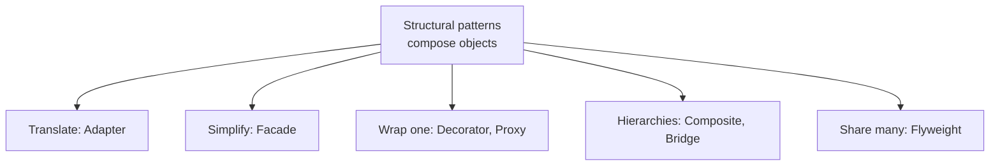

# All Structural Design Patterns — Family Overview

## Youtube

- [32. All Structural Design Patterns | Decorator, Proxy, Composite, Adapter, Bridge, Facade, FlyWeight](https://www.youtube.com/watch?v=WxGtmIBZszk)

## 1. What Are Structural Patterns?

Structural design patterns explain **how classes and objects are composed into larger structures** while keeping those structures flexible and efficient. If creational patterns are about *creating* objects and behavioural patterns about *communicating*, structural patterns are about *wiring* — interfaces, wrappers, trees, and bridges that let independently-designed parts fit together.

**The one-sentence definition:** Structural patterns use composition and delegation (has-a) instead of inheritance (is-a) to combine objects into structures that can change at runtime.

**Why they exist:**

- **Tame complexity:** Hide multi-step subsystems behind one call (Facade), or split an exploding hierarchy into two small ones (Bridge).
- **Bridge mismatches:** Make incompatible interfaces collaborate without rewriting either side (Adapter).
- **Scale cheaply:** Share common state across millions of objects (Flyweight) or treat one object and a million uniformly (Composite).
- **Control and extend:** Guard access transparently (Proxy) or stack features at runtime (Decorator).

**How to read this family:** Each of the seven pattern guides in this directory (`adapter.md`, `bridge.md`, `composite.md`, `decorator.md`, `facade.md`, `flyweight.md`, `proxy.md`) follows the same 12-section structure — overview, theory, UML (class + sequence), Java/Python/Go examples, industry uses, scenarios, when-to-use, do's and don'ts, comparisons, interviews, testing, and summary. This page is the map; those pages are the territories.

## 2. The Seven Patterns at a Glance

| # | Pattern | Intent in one line | Classic example | File |
|---|---------|--------------------|-----------------|------|
| 1 | **Adapter** | Convert an incompatible interface into one the client expects | `StripeAdapter implements PaymentProcessor` | [adapter.md](./adapter.md) |
| 2 | **Bridge** | Split abstraction from implementation so both vary independently | `Notification` → `NotificationChannel` | [bridge.md](./bridge.md) |
| 3 | **Composite** | Treat single objects and groups uniformly in a tree | File system, org chart, menu tree | [composite.md](./composite.md) |
| 4 | **Decorator** | Attach responsibilities dynamically by wrapping | `BufferedInputStream(FileInputStream)` | [decorator.md](./decorator.md) |
| 5 | **Facade** | Provide a simple front door to a complex subsystem | `VideoConverterFacade.convertToMp4()` | [facade.md](./facade.md) |
| 6 | **Flyweight** | Share fine-grained objects to support huge numbers cheaply | Glyph pool, `TreeType` forest | [flyweight.md](./flyweight.md) |
| 7 | **Proxy** | Provide a surrogate controlling access to another object | Protection, virtual, remote, cache proxies | [proxy.md](./proxy.md) |

**Memory hooks:**

- **Adapter:** "Translator" — changes the plug shape.
- **Bridge:** "Two ladders" — two hierarchies joined by one rung.
- **Composite:** "Tree" — one interface, leaves and branches.
- **Decorator:** "Toppings" — same drink, stacked extras.
- **Facade:** "Concierge" — one call, many departments.
- **Flyweight:** "Printing press" — one plate, a million impressions.
- **Proxy:** "Bouncer" — same door, checks before entry.

## 3. Comparison Matrix

| Aspect | Adapter | Bridge | Composite | Decorator | Facade | Flyweight | Proxy |
|--------|---------|--------|-----------|-----------|--------|-----------|-------|
| **Changes interface?** | Yes (translates) | No (both designed) | No (uniform) | No (same) | No (simplifies) | No (splits state) | No (same) |
| **Wraps** | One adaptee | Implementation hierarchy | Many children | Exactly one component | Whole subsystem | Shared pool + contexts | One subject |
| **Client knows?** | Sees target only | Uses abstraction | Cannot tell leaf/group | Composes stack | Sees facade | Unaware of sharing | Ideally unaware |
| **Timing** | Retroactive fix | Up-front design | Anytime tree fits | Runtime stacking | Anytime simplification | At scale | Anytime control needed |
| **Without it** | Code won't compile | M×N subclasses | Type-check soup | 2^N subclasses | Verbose sequences | Memory explosion | Scattered guards |
| **Memory** | Low | Low | Medium | Medium | Low | Sharply reduced | Low (+cache if any) |
| **Runtime** | Low | Low | Medium (traversal) | Medium (chain) | Low | Medium | Low–Medium |

**Most-confused pairs, resolved:**

- **Adapter vs Facade:** Adapter *translates signatures* (won't compile without it); Facade *orchestrates calls* (merely verbose without it).
- **Adapter vs Bridge:** Adapter fixes the past (foreign code); Bridge plans the future (your two axes).
- **Decorator vs Proxy:** Decorator *adds features* the client stacks; Proxy *guards access* invisibly.
- **Decorator vs Composite:** Decorator wraps *one* thing with layers; Composite holds *many* peers and aggregates.
- **Facade vs Mediator:** Facade simplifies *outside-in* (client to subsystem); Mediator coordinates *peer-to-peer* (colleagues via hub).
- **Flyweight vs Cache/Pool:** Flyweight shares *immutable internals* permanently; cache memoises *results* with eviction; pool recycles *mutable resources*.
- **Proxy vs Decorator vs Adapter:** Same-interface guard → Proxy; same-interface enrichment → Decorator; changed-interface translation → Adapter.

## 4. Design Principles Behind the Family

1. **Favour composition over inheritance.** Every structural pattern replaces an inheritance tangle (M×N subclasses, 2^N toppings) with a has-a link. This is the family's founding move.
2. **Program to an interface, not an implementation.** All seven patterns insert an abstraction (`Target`, `Implementor`, `Component`, `Subject`) between client and concrete. Concretes vary; contracts hold.
3. **Single Responsibility.** Decorator owns one topping; Proxy owns one gate; Facade owns one workflow; Flyweight factory owns sharing. God wrappers are the universal smell.
4. **Open/Closed.** New provider → new Adapter. New channel → new Bridge implementor. New topping → new Decorator. Extension without modification is the payoff.
5. **Dependency Inversion.** High-level policy (checkout, alerts) depends on abstractions; SDKs, channels, and transports plug in underneath.
6. **Interface Segregation.** Narrow `Target`, `Channel`, and `Subject` interfaces keep adapters, bridges, and proxies honest. Wide interfaces force `UnsupportedOperationException` everywhere.
7. **Liskov Substitution.** Any leaf substitutes for any composite; any proxy for its subject; any decorator stack for its component. Tests should prove substitutability explicitly.

## 5. Patterns Often Combined

- **Composite + Flyweight:** Trees with shared leaves — DOM nodes sharing style flyweights, org trees sharing role templates, game scene graphs sharing meshes.
- **Composite + Decorator:** Decorate a whole subtree — bordered/scrollable panels containing nested components; permission-checked menu trees.
- **Facade + Adapter:** E-commerce facade orchestrating per-provider adapters — `CheckoutFacade` calling `StripeAdapter`, `PayPalAdapter` behind one `placeOrder()`.
- **Proxy + Decorator:** Guard then enrich — `CacheProxy` in front of a decorated alerting pipeline; auth proxy outside retry decorator with documented order.
- **Bridge + Abstract Factory:** Factory builds the implementor family (EU vs US channels), Bridge consumes it — platform-independent UI and multi-tenant routing.
- **Facade + Mediator:** Gateway facade facing clients, mediator coordinating services behind it — API gateway over an event-driven core.
- **Adapter + Anti-Corruption Layer:** Legacy SOAP wrapped by adapters, orchestrated by a bounded-context facade — the standard modernisation sandwich.

## 6. Decision Guide — Which Pattern Do I Need?

**Ask in this order:**

1. **Do interfaces mismatch so code won't connect?** → **Adapter.**
2. **Is a subsystem usable but painfully verbose?** → **Facade.**
3. **Do you need combinable per-object features at runtime?** → **Decorator.**
4. **Do you need to guard, defer, or cache access to one object?** → **Proxy.**
5. **Should clients ignore one-vs-many?** → **Composite.**
6. **Are two change axes multiplying classes (M×N)?** → **Bridge.**
7. **Are millions of similar objects exhausting memory?** → **Flyweight.**
8. **Are peers tangled in mutual references?** → Mediator (behavioural) — not structural, but the usual neighbour.

**Decision tree:**

```text
Do you need to change an interface?
├─ Yes → ADAPTER
└─ No → Do you need to simplify complex interfaces?
    ├─ Yes → FACADE
    └─ No → Do you need to add behavior?
        ├─ Yes, dynamically stacked → DECORATOR
        ├─ Yes, with access control → PROXY
        └─ No → Do you work with hierarchies?
            ├─ Yes, one-or-many trees → COMPOSITE
            ├─ Yes, two independent axes → BRIDGE
            └─ No, massive similar counts → FLYWEIGHT
```

**Family map:**



**Quick smell test:** If removing the wrapper breaks compilation → Adapter. If it only makes code longer → Facade. If the caller stacks it → Decorator. If the caller can't tell → Proxy.

## 7. Performance Cheat Sheet

| Pattern | Memory | Runtime | Scales with | Watch out for |
|---------|--------|---------|-------------|---------------|
| Adapter | Low | Low (one hop) | Provider count | Leaky adaptee types |
| Bridge | Low | Low (one hop) | Axes sizes (M+N) | Leaky implementor |
| Composite | Medium (child lists) | Medium (O(n) traversal) | Tree size | Deep recursion, cycles |
| Decorator | Medium (per layer) | Medium (per-layer hop) | Stack depth | Order bugs, deep chains |
| Facade | Low | Low (one hop) | Subsystem size | God object |
| Flyweight | Sharply reduced | Medium (extrinsic passing) | Object count (flat) | Misclassified state |
| Proxy | Low (+bounded cache) | Low–Medium | Call volume | Stale cache, bypassed guards |

**Rules of thumb:** Profile before Flyweight; keep Decorator/Proxy chains shallow on hot paths; cache Composite aggregates when reads dominate; bound Proxy caches with TTL.

## 8. Structural Patterns in Modern Architectures

- **Microservices:** Adapter integrates foreign APIs; Facade is the API Gateway/BFF; Proxy is the sidecar (Envoy, Istio) and service client.
- **Cloud-native:** Proxy covers load balancers and reverse proxies; Bridge abstracts multi-cloud drivers (S3 vs GCS); Flyweight thinking drives shared caches (Redis, CDN tiles).
- **Frontend:** Composite is the component tree (React/Vue/DOM); Decorator is HOCs, hooks, and middleware; Facade is the store API (Redux/Zustand) over reducers and effects.
- **Data/ML:** Facade fronts feature pipelines (`train()` hiding extract/validate/encode); Adapter normalises vendor datasets; Proxy caches feature-store lookups; Flyweight shares embeddings/token tables.
- **DDD:** Adapter is the anti-corruption layer between contexts; Facade is the application service; Composite models aggregates containing entities.

## 9. Anti-Patterns and Code Smells

- **Adapter stack:** `AdapterA(AdapterB(AdapterC(x)))` — debugging through three translations. Consolidate or redesign the boundary.
- **God Facade:** 40-method `SystemManager` with mutable state. Split by workflow or client view.
- **Leaky Bridge:** Abstraction downcasting to `SmsChannel` specifics. Narrow the implementor contract.
- **Transparent-everything Composite:** Leaves throwing `UnsupportedOperationException` for `add()`. Prefer the safe style.
- **Order-fragile Decorators:** Five layers where every permutation behaves differently. Bless and factory-build valid orders.
- **God Proxy:** Auth + cache + retry + metrics in one class. One concern per proxy, composed explicitly.
- **Premature Flyweight:** Pool machinery for 200 small objects. Measure heap first; YAGNI otherwise.

## 10. Interview Quick-Fire Map

- **"Adapter vs Facade vs Bridge?"** Signatures fixed → Adapter; steps simplified → Facade; two axes split → Bridge.
- **"Decorator vs Proxy?"** Client stacks features → Decorator; wrapper guards invisibly → Proxy.
- **"Composite vs Decorator?"** Many peers aggregated → Composite; one object enriched → Decorator.
- **"Flyweight vs Singleton vs Cache?"** Many shared instances → Flyweight; one instance → Singleton; memoised results → Cache.
- **"Class vs object adapter?"** Inheritance vs composition — prefer object adapters; class adapters only to override adaptee behaviour.
- **"How do you test a Proxy/Adapter/Facade?"** Real subject alone; wrapper with stubbed inner; order/translation assertions; one end-to-end proof.
- **Framework examples to cite:** JDBC drivers (Bridge), `BufferedInputStream` (Decorator), SLF4J (Adapter/Bridge), Spring Security/AOP (Proxy), `EntityManager` (Facade), `String.intern()` (Flyweight), DOM/React tree (Composite).

## 11. Suggested Learning Order

1. **Facade → Adapter:** Simplification first, then translation — the two most common daily needs.
2. **Decorator → Proxy:** Same-interface wrapping, first explicit then invisible — the classic confusion pair.
3. **Composite → Flyweight:** Trees first, then sharing leaves — the scale story.
4. **Bridge last:** The most abstract split — clearest once Adapter (fix) vs Strategy (swap) are understood.
5. **Capstone:** Revisit this overview's decision tree and re-derive each choice from a real codebase you own.

*Each pattern file ends with 8+ Q&A and 2–3 LLD scenarios — work them in the same order for design-round preparation.*

## 12. Worked Selection Walkthrough

A single evolving scenario shows how the decision tree picks different patterns as the problem changes.

**Stage 1 — Messy video library:** `UploadController` calls extractor, transcoder, normaliser, and muxer directly, in an order copied between three controllers. Two bugs this quarter came from swapped steps. **Pick Facade:** `VideoConverterFacade.convertToMp4()` owns the order; controllers drop to one call; subsystem stays public for custom-bitrate jobs.

**Stage 2 — New cloud encoder SDK:** The team wants to swap the in-house transcoder for a vendor SDK whose method names and error codes differ. **Pick Adapter:** `VendorTranscoderAdapter` implements the internal `Transcoder` interface and translates to the SDK. The facade never changes; migration is one wiring edit plus a feature flag.

**Stage 3 — Per-customer delivery options:** Enterprise tenants want email plus Slack plus encrypted archive; free tier wants email only. Subclassing every mix is hopeless. **Pick Decorator:** `Retry(Encrypt(Slack(Email)))` for enterprise, bare `Email` for free — composed per tenant at runtime.

**Stage 4 — Abuse and cost:** Alerts now fire 10k times per incident because every retry re-sends. **Pick Proxy:** a rate-limiting proxy and a cache proxy (dedupe identical alerts within 5 minutes) sit in front of the pipeline. Product features untouched; access policy centralised.

**Stage 5 — Two delivery axes:** Message kinds (urgent, reminder, marketing) multiply against channels (email, SMS, push, WhatsApp) — 12 subclasses and counting. **Pick Bridge:** `Notification` hierarchy × `NotificationChannel` hierarchy, wired by tenant config. Twelve classes collapse to seven, and the next channel is one class.

**Stage 6 — Org-wide rollout:** Notifications now target teams with nested sub-teams, and finance needs cost roll-ups. **Pick Composite:** `OrgUnit` with `Developer` leaves and `Team` composites; `notifyAll()` and `monthlyCost()` recurse uniformly.

**Stage 7 — Million-device fan-out:** Device tokens and message templates repeat enormously; heap pressure spikes. **Pick Flyweight:** share template/style flyweights across contexts, pass device id and position extrinsically. Memory flattens while throughput holds.

The lesson: each stage's pain maps to exactly one decision-tree question, and patterns compose — the final system runs Facade over Adapters, Decorators behind Proxies, Bridges feeding Composites with Flyweight leaves.

## 13. Minimal Skeleton Comparison

When reviewing code, these skeletons distinguish the patterns faster than prose:

```java
import java.util.*;

// ADAPTER: translates signatures
interface PaymentProcessor { String pay(double inr); }
class StripeGateway { String createCharge(long paise) { return "ch_" + paise; } }
class StripeAdapter implements PaymentProcessor {
    private final StripeGateway adaptee = new StripeGateway();
    public String pay(double inr) { return adaptee.createCharge(Math.round(inr * 100)); }
}

// BRIDGE: two hierarchies, one composition link
interface NotificationChannel { void send(String m); }
abstract class Notification {
    protected final NotificationChannel channel; // bridge
    Notification(NotificationChannel c) { channel = c; }
    abstract void notify(String m);
}

// COMPOSITE: one holds many of the same interface
interface OrgUnit { double monthlyCost(); }
class Team implements OrgUnit {
    private final List<OrgUnit> members = new ArrayList<>();
    public double monthlyCost() { return members.stream().mapToDouble(OrgUnit::monthlyCost).sum(); }
}

// DECORATOR: one wraps exactly one, same interface
interface Notifier { void send(String m); }
class RetryDecorator implements Notifier {
    private final Notifier wrapped;
    RetryDecorator(Notifier w) { wrapped = w; }
    public void send(String m) { wrapped.send(m); }
}

// FACADE: one method orchestrates many subsystems
class Order {}
class Payments { void charge(Order o) {} }
class Stock { void reserve(Order o) {} }
class Shipping { void dispatch(Order o) {} }
class OrderFacade {
    private final Payments payments = new Payments();
    private final Stock stock = new Stock();
    private final Shipping shipping = new Shipping();
    public void placeOrder(Order o) { payments.charge(o); stock.reserve(o); shipping.dispatch(o); }
}

// FLYWEIGHT: pool + tiny contexts
class Glyph { Glyph(String c) {} }
class GlyphFactory {
    private final Map<String, Glyph> pool = new HashMap<>();
    Glyph get(char c) { return pool.computeIfAbsent(String.valueOf(c), Glyph::new); }
}

// PROXY: same interface, gate in front
class Doc {}
class Denied extends RuntimeException {}
class Role { boolean canRead() { return true; } }
interface DocumentStore { Doc read(String id); }
class RealStore implements DocumentStore { public Doc read(String id) { return new Doc(); } }
class AccessProxy implements DocumentStore {
    private final DocumentStore real = new RealStore(); private final Role caller = new Role();
    public Doc read(String id) { if (!caller.canRead()) throw new Denied(); return real.read(id); }
}
```

**Review heuristic:** count what the wrapper holds — one adaptee with renamed methods (Adapter), one implementation hierarchy (Bridge), many children (Composite), one component with extras (Decorator), many subsystems (Facade), a pool with contexts (Flyweight), one subject with a gate (Proxy).

## 14. Family-Wide Testing and Adoption Checklist

- **Substitutability first:** every wrapper (Adapter, Decorator, Proxy) and every node (Composite leaf/group) must pass the same interface-level tests. Write one contract suite per interface and run all implementations through it.
- **Order and translation assertions:** Facade tests verify call order; Adapter tests verify unit/error translation; Decorator/Proxy tests verify delegation counts with mocked inners.
- **Matrix and identity tests:** Bridge needs abstraction × implementor matrix tests; Flyweight needs reference-equality (`get(k) == get(k)`) and sibling-isolation tests.
- **One real end-to-end per seam:** a thin integration test with genuine subsystems (sandbox SDK, test SMTP, in-memory channel) proves the wiring beyond mocks.
- **Adoption checklist:** name the pain with the decision tree, keep wrappers thin and single-concern, inject dependencies for tests, document ordering and key design, measure (heap/latency) before and after Flyweight/Proxy changes, and allow Facade bypass for power users.
